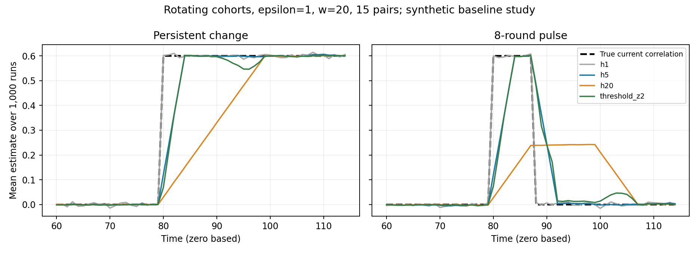

# 第六次讨论：多属性对最小实验与误差指标

日期：2026-10-15。接续[第五次讨论](2026-10-14-第五次讨论-误差分解与强基线核查.md)。本轮首次运行随机合成实验；之前的数值仅为公式代入。本轮是基线排查，不是新算法或最新论文的完整复现。

## 1. 先看结论

1. 在本轮设置中，用户分组轮换明显强于每轮均匀拆预算。
2. 简单的双窗口后处理已经缓解相当一部分滞后；“自适应平滑关联统计”本身不足以立项。
3. 更关键的是：少量属性对只短暂变化时，全局平均误差可以给“始终输出零、完全不响应变化”的方法较好排名。必须先明确研究究竟重视哪些时刻、哪些属性对。
4. 当前值得继续验证的是：固定窗口隐私预算，兼顾稳定期估计精度与短暂关联变化期间的跟踪误差。尚未证明现有方法解决不了。

## 2. 实验设计：有效的多维分布，而不是随意拼相关系数

- 6 个二元属性，X_i∈{-1,+1}，共 15 个待估计属性对。
- 每轮 42000 个同分布用户，240 轮；评价忽略前 40 轮预热，但预热报告照常计入隐私预算。
- 1000 次独立 Monte Carlo 重复；种子 20261015；ε∈{0.3,1,3}，w=20。
- 当前总体交叉矩 ρ_(j,t)=E[X_aX_b] 是估计目标；用户间、时间间独立，不模拟用户异质性或时间依赖。
- 三个独立二元块 (X1,X2)、(X3,X4)、(X5,X6)，各块概率为 (1+ρxy)/4。这样联合分布合法、全部单属性边际恒为均匀分布，其余 12 个交叉矩为零。
- 第 81、121、161 轮（代码索引 80、120、160），上述三对分别从 0 变为 +0.6、−0.6、+0.6。
- 两个场景：变化后持续保持；变化只持续 8 轮后回到零。
- 方法始终观察全部 15 对，不预先告知哪三对会变化、何时变化。真实参数仅供生成数据与离线评价。

二元边际已知为均匀时，联合概率由 ρ 唯一确定：同号两格各为 (1+ρ)/4，异号两格各为 (1−ρ)/4。因此，本实验的交叉矩平方误差等于四格联合概率平方误差之和的 4 倍。这个联系只适用于该受控二元设置，不能推广为所有联合分布变化都等同协方差变化。

## 3. 比较的基线与预算账本

| 名称 | 采集与计算 | 每对每轮报告数 |
|---|---|---:|
| uniform_h | 用户公开均分给 15 对；每人每轮做预算 ε/w 的交叉符号随机响应；取最近 h 轮平均 | 2800 |
| rotating_h | 每对的用户再分 20 组，轮换上报；每人 20 轮一次，用 ε；取最近 h 轮平均 | 140 |
| rotating_threshold_z2/z3 | 与 rotating 完全相同的报告；简单双窗口后处理 | 140 |
| constant_zero | 不采集，始终预测全部关联为零；用于诊断指标 | 0 |

固定 h∈{1,5,20,40}。所有主比较均将最终估计截断到 [-1,1]，防止故意用未截断的弱基线。

双窗口基线：比较最近 5 轮与之前 15 轮的私有估计均值。设每轮估计方差上界 V=1/(140 tanh²(ε/2))，若两均值之差的绝对值超过 z√(V(1/5+1/15))，输出最近 5 轮均值，否则输出最近 20 轮均值。z 固定为 2 或 3；没有按真实变点或结果调参，也没有新增采集预算。

这是为检验问题而实现的常规阈值后处理对照，不是 MTSP-LDP，也不声称提供全程误报保证。阈值选择的输出有数据依赖，所以本轮直接用重复实验估计误差，没有套用固定权重的无偏公式。

隐私说明：每用户只属于一个属性对；uniform 在每个连续 20 轮的预算和为 ε；rotating 在任意连续 20 轮恰好参与一次。公开调度与私有数据无关。每次随机响应是对整条属性记录的 ε 或 ε/w 局部隐私机制。后处理不增加预算。

通信口径：每用户每轮最多一个报告比特；属性对和轮次由公开调度确定，未假装免费传私有选择的编号。两种方法通信上限相同，rotating 实际报告更少；不把通信数量不同隐藏起来。

## 4. 如何运行与检查

[完整代码](analysis/2026-10-15-multipair/run_experiment.py)，运行：

```text
python paper-ideas/analysis/2026-10-15-multipair/run_experiment.py
```

依赖：numpy、matplotlib；具体环境与参数见 [metadata.json](analysis/2026-10-15-multipair/metadata.json)。

代码直接从 Binomial(r,(1+κρ)/2) 生成每对每轮的“报告 +1 的人数”。在不同属性对由不同用户负责、数据跨用户和时间独立的模型下，这与逐用户生成记录、随机响应再汇总有相同分布；不是在真实关联值上随意添加高斯噪声。

验证包括：枚举 64 个原始状态检查分布合法、单属性均值和交叉矩；枚举全部组相位检查滑动预算；将未截断 h=1 的模拟误差与精确公式核对。12 个场景/预算/采集组合的最大相对偏差为 0.1612%。

第一轮运行后发现全局指标可能掩盖短事件，补入固定零输出的诊断对照；未调整原方法或超参数，重新运行仍使用原种子。

## 5. 指标定义

- **全局 MSE**：预热后全部时刻、全部 15 对及重复实验的平均平方误差。
- **变化后 10 轮 MSE**：只评价三个变化属性对各自在起始变化后的 10 轮，再平均；短脉冲场景包含 8 轮事件和 2 轮恢复。它不是只评价事件存在时的误差。
- **逐时刻最差属性对 MSE 的时间平均**：先对重复实验求各时刻各对的 MSE，再在每时刻取属性对最大值，最后对时间平均。它不是单次实验中最大平方误差的平均。
- 全局和变化后 MSE 给出独立重复层面的正态近似 95% Monte Carlo 区间；最差属性对指标仅作点估计。区间不表示真实场景外推的不确定性。

## 6. 结果：ε=1、w=20

### 6.1 持续变化

| 基线 | 全局 MSE | 变化后 10 轮 MSE | 最差属性对 MSE 的时间平均 |
|---|---:|---:|---:|
| 每轮均匀预算，h=5 | 0.11169 | 0.14669 | 0.12857 |
| 每轮均匀预算，h=20 | 0.03073 | 0.22759 | 0.06389 |
| 用户轮换，h=1 | 0.03307 | **0.02990** | 0.03594 |
| 用户轮换，h=5 | 0.00705 | 0.04926 | 0.01361 |
| 用户轮换，h=20 | 0.00388 | 0.19874 | 0.03518 |
| 用户轮换，双窗口 z=2 | 0.00355 | 0.05738 | **0.01235** |
| 用户轮换，双窗口 z=3 | **0.00262** | 0.07062 | 0.01430 |

双窗口 z=2 相比 h=20，变化后误差约下降 71%；配对差值为 −0.14135，95% Monte Carlo 区间 [−0.14234,−0.14037]。但其变化后误差仍高于 h=1 和 h=5。现有简单处理已经有明显作用，未出现一个方法在所有指标上占优。

### 6.2 仅持续 8 轮的变化

| 基线 | 全局 MSE | 变化后 10 轮 MSE |
|---|---:|---:|
| 始终输出零 | **0.00288** | **0.28800（完全没有跟踪）** |
| 用户轮换，h=1 | 0.03348 | 0.03135 |
| 用户轮换，h=5 | 0.00757 | 0.08630 |
| 用户轮换，h=20 | 0.00427 | 0.19067 |
| 用户轮换，双窗口 z=2 | 0.00408 | 0.09101 |
| 用户轮换，双窗口 z=3 | 0.00317 | 0.09717 |

固定零输出的全局 MSE 可直接算出：3×8×0.6²/(200×15)=0.00288。它在这张表的全局指标上最好，却完全漏掉变化。全局平均衡量的是当前定义的平均损失，本身没有算错；若任务真正重视短暂变化，这个评价权重便不足以代表需求。

全局指标适合什么任务，必须先说清楚。不能仅在得到结果后选择对某方法最有利的指标；下一轮应先固定稳定期与变化期的效用要求。

### 6.3 预算改变后，排名也会变

持续变化，用户轮换方案的变化后 10 轮 MSE：

| ε | h=1 | h=5 | h=20 | 双窗口 z=2 |
|---:|---:|---:|---:|---:|
| 0.3 | 0.21205 | **0.10582** | 0.21759 | 0.17327 |
| 1 | **0.02990** | 0.04926 | 0.19874 | 0.05738 |
| 3 | **0.00619** | 0.04439 | 0.19654 | 0.04605 |

预算较小时，单轮太不稳定，积累 5 轮更好；预算较大时，单轮精度足够，平滑的滞后代价更突出。这里只比较固定规模与变化幅度，不由三档预算推出通用最优规律。



图显示 1000 次运行的平均估计，不是单次运行，h=1 曲线看似贴近真值不代表其方差很小；应结合表中的 MSE 阅读。均值轨迹中的回落也说明该简单阈值后处理不是完善的变化跟踪方法。

## 7. 与既有工作怎样对接

- [MTSP-LDP，SIGMOD 2026](https://arxiv.org/html/2512.24899v1) 已有私有差异估计和预算决策。本轮阈值后处理没有复现它；不能拿本轮表格声称优于它。直接适配路径仍可行：公开分用户给属性对，将交叉符号视作二类流，各组各自运行原机制，每用户只参加一组，避免重复给预算。
- [SIGMOD 2018 低阶 Hadamard 方法](https://arxiv.org/pdf/1711.02952)仍是必要参照。在本实验只估计二阶交叉项、单属性边际已知的特殊任务里，单次采样一个二阶系数，就是采样某个 X_aX_b 再随机响应。因此该受限二阶采样变体与属性对采样使用同一种信息，不能包装成两个独立优势。原文的完整低阶边缘发布、其他投影或交互共享机制并未被排除。
- 人口分组沿用[LDP-IDS 的已有思路](https://wrap.warwick.ac.uk/id/eprint/164175/)，本轮不是该论文完整算法复现。

## 8. 对研究问题的收敛建议

可以继续验证这个具体问题：

> 多属性流中，少量属性对出现未知起止时间的关联变化；在给定 w-event LDP 预算和稳定期估计误差要求下，变化期间及变化后短时间的联合统计跟踪误差能否改善？

该问题有清楚的隐私约束、误差目标和可运行对照。但“短事件容易被平滑掉”本身是常见现象；本轮只验证其在一个 LDP 多属性基线中的表现，没有证明新研究空白。

目前可确认的事实：需要在稳定数据的估计精度与快速变化的跟踪误差之间做明确评价，预算会改变这个权衡；仅优化全局平均误差可能无法满足事件敏感的任务需求。

## 9. 下一步与局限

下一步应先完成近期方法的直接适配：优先 MTSP-LDP 或其公开实现/经原文核对的预算决策模块，与本轮简单基线在同一用户分组、隐私账本和统计目标下比较。原机制的完整复现与模块适配要分开命名。

在运行新方法前固定主要效用要求，选择稳定期误差约束下的变化期误差，或事先确定的加权损失；不能随结果改口径。随后再扩展属性数、变化幅度和事件持续时间，判断困难是否稳定存在。

局限：只有一个用户数、一个属性数、同分布独立用户、两个手工场景、三个预算；未覆盖真实数据、时间依赖、异质用户、大域属性、多对共享机制或一般理论下界。未复现 MTSP-LDP/SPAS，尚不能宣称优于最新方法，也不把本次实验当作选题已成立。

## 10. 可复查产物

- [汇总结果及区间](analysis/2026-10-15-multipair/summary.csv)
- [同报告配对差值](analysis/2026-10-15-multipair/paired_differences.csv)
- [解析公式核对](analysis/2026-10-15-multipair/analytic_checks.csv)
- [首个属性对轨迹数值](analysis/2026-10-15-multipair/first_pair_trace.csv)
- [可缩放图](analysis/2026-10-15-multipair/tracking.svg)

本轮完成了最小实验和分析；下一步的关键是强方法的公平适配，尚未进入新算法设计。
