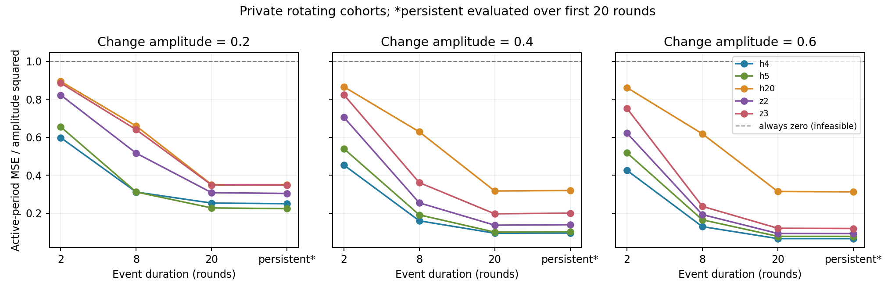

# 第八次讨论：稳健性验证与预算变化下的误差校正

日期：2026-10-16。接续[第七次讨论](2026-10-15-第七次讨论-OBA模块适配与稳定期约束.md)。本轮完成了新实验、独立公式核对和文献模块审阅。

## 1. 现在讨论到哪里了

**普通轮换采集加短窗口平均，比前一轮看到的还强。现有证据不足以支持“需要新的动态预算算法”。**

本轮新增的4轮平均，是从稳定期误差要求直接算出来的。它在12组场景中的10组获得最低活跃期误差点估计，其中1组与5轮平均几乎持平；另2组由5轮平均略胜。这里的比较只限本轮测试的方法。

同时发现一个更具体、直接涉及隐私预算与误差的问题：**预算改变后，历史与当前估计的噪声方差不相同；用同方差的校正公式评价“数据是否变化”，可能产生系统偏差。**我们已用独立数学例子和随机响应实验核实这个现象，但没有证明它是现有文献未解决的创新点，也没有完成整篇论文复现。

## 2. 本轮实际运行了什么

先写[运行前协议](analysis/2026-10-16-robustness/PROTOCOL.md)，再执行[主脚本](analysis/2026-10-16-robustness/run.py)。

- 42000名用户，6个二元属性、15个属性对，240轮，w=20、ε=1。
- 每对每轮140名用户报告；同一用户每20轮报告一次，每次使用ε=1的随机响应。任意20轮内最多1比特、总预算不超过1。
- 变化幅度固定为0.2/0.4/0.6；持续时间固定为2/8/20轮或持续变化，共12组动态场景。
- 另有独立稳定对照：三个属性块关联为0.2、−0.4、0.6，其余关联为0。每场景1000次重复。
- 方法：轮换+h1/h4/h5/h20/h40、原有双窗口阈值z2/z3、始终输出零。方法共享同一批私有报告，比较差值采用配对重复。
- 合法联合分布、边际稳定、公开轮换隐私账本均已检查。230项未截断解析误差与模拟对照的最大相对差为2.77%；不是每项理论值都必须落在各自95%区间内。

依旧假设用户同分布、记录跨用户和时间独立。预算约束是机制结构上的保证；这里的效用结果依赖合成模型。通信量只是固定条件，主线仍是隐私预算与估计误差。

### 为什么补入4轮平均

这是自己的固定基线分析。令 κ=tanh(ε/2)，r=140。在关联保持ρ时，未截断h轮平均的总体MSE为：

$$\frac{\kappa^{-2}-\rho^2}{rh}.$$

稳定对照中包含ρ=0的属性对，最坏值为0.03344782/h。要达到之前固定的工作门槛0.01，按这个公式选择的最小整数是h=4，理论上界0.00836195。截断到[-1,1]不会增加平方误差。

所以，h4应当作为普通基线补上，不能把此前候选集合遗漏它造成的差距当作创新空间。这只是当前采集与固定均值估计族的分析，不是一般LDP下界或全体机制的最优窗口证明。

## 3. 结果：简单方法仍有竞争力

### 稳定对照

以下“最大对误差”是**先对时间和重复取平均，再在属性对之间取最大**，不是每个时刻的最差对误差。

| 方法 | 稳定最大对MSE | 通过0.01点估计门槛 |
|---|---:|---|
| 轮换+h1 | 0.03355 | 否 |
| 轮换+h4 | 0.00842 | 是 |
| 轮换+h5 | 0.00675 | 是 |
| 轮换+h20 | 0.00169 | 是 |
| 轮换+h40 | 0.00086 | 是 |
| 轮换+z2 | 0.00303 | 是 |
| 轮换+z3 | 0.00185 | 是 |
| 始终输出零 | 0.36000 | 否 |

0.01仍是工作诊断阈值，没有实际应用依据。不能因为它淘汰h1，就认定已经证明新算法的必要性。

### 12组变化的活跃期误差

有限事件使用全部活跃轮；持续变化只评价起点后20轮。不是用真实变点帮助算法调参。

| 幅度 | 持续轮数 | h4的MSE | h5的MSE | 合格方法中最低点估计 |
|---:|---|---:|---:|---|
| 0.2 | 2 | 0.02390 | 0.02618 | h4 |
| 0.2 | 8 | 0.01243 | 0.01245 | h4，近乎持平 |
| 0.2 | 20 | 0.01011 | 0.00909 | h5 |
| 0.2 | 持续 | 0.00999 | 0.00894 | h5 |
| 0.4 | 2 | 0.07258 | 0.08636 | h4 |
| 0.4 | 8 | 0.02551 | 0.03052 | h4 |
| 0.4 | 20 | 0.01504 | 0.01596 | h4 |
| 0.4 | 持续 | 0.01518 | 0.01622 | h4 |
| 0.6 | 2 | 0.15323 | 0.18657 | h4 |
| 0.6 | 8 | 0.04634 | 0.05929 | h4 |
| 0.6 | 20 | 0.02357 | 0.02785 | h4 |
| 0.6 | 持续 | 0.02350 | 0.02780 | h4 |

固定使用h4时，12组误差均不超过该组“已测试合格方法最低点估计”的1.118倍。这个比值只描述本次网格，不能当作竞争比保证，也不能把按场景挑选的最优窗口当成可部署算法。

幅度0.2、持续8轮时，h4−h5的配对误差差为−0.0000173，95% Monte Carlo区间为[−0.0001101, 0.0000755]，没有明确胜负。区间只反映本合成模型的模拟精度，没有跨场景同时覆盖保证。

图中纵轴是活跃期MSE除以幅度平方。虚线1对应完全忽略事件、始终输出零的误差；该方法不通过稳定对照。图显示的是误差均值，不是平均轨迹。

### 不能只看活跃期，也不能只看恢复期

以幅度0.6、持续8轮为例：

| 方法 | 活跃8轮MSE | 归零后10轮MSE |
|---|---:|---:|
| h4 | 0.04634 | 0.04004 |
| h5 | 0.05929 | 0.04998 |
| h20 | 0.22253 | 0.05973 |
| h40 | 0.28587 | 0.01524 |
| z2 | 0.06919 | 0.04992 |
| z3 | 0.08482 | 0.05360 |

h4相对h5的活跃期误差约低22%，恢复后10轮约低20%。h40恢复指标较低，却在事件期间误差很大；其长尾还可能超出10轮评价区间，不能据此说恢复更好。本轮保持预设的return10指标，没有事后换成有利于某个方法的新主指标。

## 4. 对上轮OBA适配的重新审阅

核对来源为[MTSP-LDP arXiv v1](https://arxiv.org/html/2512.24899v1)；2026-10-16的[版本页](https://arxiv.org/abs/2512.24899)仍列v1。ACM页面本轮返回403，未核实正式版本正文是否有改动。

原文§2.6明确允许人口划分用于MTSP-LDP；Algorithm 1和§3.2用分组平滑后的发布结果参与下一轮决策；§3.4.2 Theorem 3.2的分组校正包含(l+1)V_t/l，其推导把历史平均方差写成V_t/l。[对应原文](https://arxiv.org/html/2512.24899v1#S3.SS4.SSS2)

**对我们实验的影响：**

1. 第七轮是“大预算轮换基线”对“小预算逐轮OBA模块”的有限比较，混合了采集安排与决策方法的作用。
2. 代码中的h5/h20只在最后平滑，下一轮预算决策仍用raw发布值。它们不能替代原文反馈流程。
3. 直接移植分组公式到不同预算、历史发布复用的标量流时，需要说明方差、协方差、零预算以及分组选择的处理。暂不把含糊约定包装成完整复现。

未发现上轮枚举k或窗口账本的明显实现错误。上述限制不说明论文的隐私保证失效，也不支持“整篇方法弱于简单平均”的结论。

## 5. 新核实的具体统计问题：噪声差异会进入变化评分

以下是**独立推导与隔离实验**，不是完整GroupSmooth性能实验。

假设两轮真实统计都为0；估计Y_old、Y_now独立且无偏，方差分别为V_old、V_now。则：

$$E[(Y_{now}-Y_{old})^2]=V_{now}+V_{old}.$$

若套用两轮同方差时的校正，减去2V_now，剩下的期望为：

$$V_{old}-V_{now}.$$

**数据没有变化，评分却可能偏正或偏负。**这不是关联估计Y本身有偏，而是“真实变化平方”的估计校正不匹配。

### 用真实随机响应核对

每轮2800条固定记录，正负符号各1400条，真实关联均为0；两轮用独立随机数、不截断。每用户只在这两轮上报，预算之和≤1，可置于w=20窗口内。条件机制方差为：

$$V(a)=\frac{\coth^2(a/2)-1}{2800}.$$

运行[隔离脚本](analysis/2026-10-16-robustness/check_variance.py)，每个预算组合20万次重复：

| 前轮预算→当前预算 | 同方差校正后的理论期望 | 模拟均值 |
|---|---:|---:|
| 0.1→0.5 | +0.137141 | +0.137202 |
| 0.5→0.1 | −0.137141 | −0.137381 |
| 0.3→0.3 | 0 | −0.000128 |

在这里预算固定、两轮独立时，改用V_old+V_now即可消除该期望偏差；相应模拟区间均覆盖0。这是基础统计校正，**单独这一改动不足以构成论文创新**。

如果历史包含复制结果，须考虑协方差；如果预算、历史组和权重由私有观测自适应决定，固定组的公式也不能直接当作选择后的无偏保证。这些复杂情形本轮尚未实证完成。

还要区分两个目标：上轮OBA的差异分数，是“当前真实记录统计与已经实现的上次发布值”的距离；在条件于上次发布值时，减去当前监测方差有其依据。**不能把本节两轮真实均值之差的公式，直接拿来指控那个不同目标的分数错误。**

## 6. 对选题的影响：暂时降低哪条路线，继续核查什么

原路线“发现新关联，所以需要新动态预算分配”目前证据偏弱。简单采集与平滑已在预设网格中表现有竞争力；还没有用户确定的应用误差要求，不能断言它们已经满足实际需求。

更具体的待核查问题可以写成：

> 在w-event LDP数据流中，各轮预算不同、历史发布值可能被复用时，怎样可靠评价真实关联变化与时间平滑误差，避免噪声尺度差异影响后续预算选择？

它与原方向的关系很直接：数据持续到来；预算决定噪声方差；变化评分影响是否平滑、是否发布和如何分配后续预算；最终评价的是当前关联统计的误差。

但目前只是**值得查清的统计适用条件**。需要先排除现成的异方差校正、协方差处理和自适应推断方法。若这些普通处理已解决问题，应停止把它升级为新选题。不能仅凭本文一个公式的移植疑问宣称2025—2026文献存在普遍空白。

## 7. 下一步，以及这轮没有完成的部分

1. 优先澄清原文GroupSmooth的实际方差、复用与反馈约定，并核查正式版本/作者实现。本文仍是v1层面的复现审阅。
2. 保留简单轮换+h4/h5作为必须超越的基线；进一步比较现成的自适应平滑，先看是否已经解决误差取舍。
3. 若继续研究预算变化评分，先固定其估计目标：是真实统计之差，还是相对历史已发布值的预测误差。二者不能混用。
4. 再检索2025—2026工作是否已经处理动态预算下异方差、发布复用及分组选择；确认实际影响后再讨论创新。当前不设计完整新方案。

代码与全部结果在[本轮实验目录](analysis/2026-10-16-robustness/PROTOCOL.md)：主结果96行、稳定对照、配对差值、解析核对、参数元数据、PNG/SVG图及方差隔离实验均已保存。主实验运行命令为`python paper-ideas/analysis/2026-10-16-robustness/run.py`，隔离核对为同目录`check_variance.py`。

**本轮完成的是：加强普通基线、削弱不必要的新机制假设，并核实一个更具体的预算—误差校正问题。尚无确认的新颖性、完整MTSP-LDP复现或新的隐私机制。**
