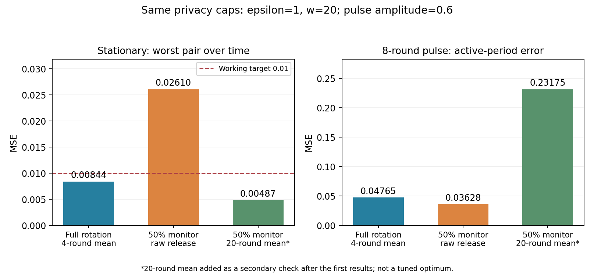

# 第十次讨论：监测成本与最终发布误差验证

日期：2026-10-26。接续[第九次讨论](2026-10-16-第九次讨论-复用与选择偏差验证及文献查重.md)。

> 后续更新（2026-10-27）：[第十一次讨论](2026-10-27-第十一次讨论-反馈平滑与报告复用后的误差验证.md)已补反馈平滑与监测报告复用消融，并核查临界稳定误差及选择依赖。本页保留第十轮快照。

## 1. 这轮真正推进了什么

前一轮主要验证评分是否有偏。本轮直接运行完整的“监测—选择发布人数—更新或沿用旧值”循环，评价**最终发布的当前总体关联统计MSE**。

结论是有条件的：

- 方差校正不仅改善评分，也确实降低了本轮适配的最终发布误差。
- 独立监测可以更快跟踪部分强短变化，但同时增加了稳定期误差。
- 延长平滑窗口能让稳定期达标，却损失了短事件跟踪收益。
- 尚未找到在沿用稳定期要求下，优于普通轮换+h4/h5的监测方案；这不等于证明所有监测方案都不值得。

**这是一项已有思路的适配验证，不是新算法，也不是MTSP-LDP完整复现。**

## 2. 为什么换用人口轮换的监测对照

第七轮的OBA模块使用逐轮小额预算，普通基线却使用完整预算的用户轮换，混合了采集安排与预算决策的差异。本轮让监测方案也使用用户轮换，减少这一混淆。

适配参考LDP-IDS的Algorithm 3（LPD）及Appendix B.1：一部分用户监测；另一部分用户在需要更新时参与发布；每轮候选发布人数取当前可用人数的一半；已报告用户经过w轮后才可重用。[原文](https://arxiv.org/pdf/2204.00526)

MTSP-LDP §2.6也明确允许人口划分。它与ICDE 2025 Dual Utilization仍是近期研究背景；2026-10-26核对的两篇arXiv版本页均仍列v1。本轮没有补齐其整篇实现。[MTSP-LDP正文](https://arxiv.org/html/2512.24899v1#S2.SS6)、[版本页](https://arxiv.org/abs/2512.24899)、[Dual Utilization版本页](https://arxiv.org/abs/2504.14993)

## 3. 条件、规则和适配边界

先保存[运行前协议](analysis/2026-10-26-monitoring-cost/PROTOCOL.md)，再运行[脚本](analysis/2026-10-26-monitoring-cost/run.py)。

- 42000用户，6个二元属性、15个属性对，每对2800人；ε=1、w=20、240轮。
- 记录跨用户和时间独立，用户同分布，单属性边际不变。目标为当前总体ρ_t，不是当轮有限样本均值。
- 每用户任意20轮最多参与一次，每次发1比特RR报告，使用完整ε=1。
- 监测用户占比α=0.25或0.5；每对每轮分别35或70人用于监测，发布用户池分别为2100或1400人。
- α是用户报告额度分配，不是把同一个人的ε拆成两份。监测与发布使用不同用户。
- 场景预设为幅度0.2/0.6 × 时长2/8/持续，共6组动态场景，加独立稳定对照；每场景1000次重复。
- 稳定对照沿用三块关联(0.2,−0.4,0.6)。前40轮不参与效用汇总，但全部报告计入账本。
- 算法不知变点。有限事件评价全部活跃轮，持续变化评价前20轮；恢复评价归零后10轮。

### 评分如何计算

令H为上一轮实际发布值，Y为当前监测RR均值，r为监测人数，κ=tanh(ε/2)。在当前总体模型下：

$$\operatorname{Var}(Y)=\frac{\kappa^{-2}-\rho_t^2}{r}.$$

使用报告自身可计算的无偏方差估计：

$$\widehat V=\frac{\kappa^{-2}-Y^2}{r-1},\qquad D=(Y-H)^2-\widehat V.$$

给定历史，E[D]=(ρ_t−H)²。这个恒等式用18组有限二项分布精确求和核查，不靠知道真值来计算算法评分。

候选发布人数为剩余池的一半，向下取整。若D大于候选发布方差上界κ⁻²/r_pub，则更新；否则沿用H。当前发布使用新用户和新随机数，结果截断到[-1,1]。负D保留。初始化H=0；稳定对照含非零关联，不能靠一直输出0通过要求。

**与原论文的差异：**二元交叉统计、总体误差口径、无偏方差估计、未知ρ时的发布方差上界，以及固定角色用户池都是本轮明确约定；α=0.25是资源消融。没有树结构、GroupSmooth或复杂查询。因此称“LPD标量适配”，不称原论文逐行复现。

## 4. 评分校正确实降低了最终发布误差

固定α=0.5，比较校正评分D与未扣方差的(Y−H)²。两者使用相同隐私上限和调度规则，但实际发布路径会变化。

以幅度0.6、持续8轮为例：

| 方案 | 全局MSE | 事件活跃期MSE | 稳定对照最差属性对MSE |
|---|---:|---:|---:|
| 未校正评分，直接发布 | 0.04084 | 0.04835 | 0.04107 |
| 校正评分，直接发布 | 0.02571 | 0.03628 | 0.02610 |

全局MSE约下降37%。稳定场景的发布频率也从约47.3%降到27.6%。这只是发布频率，不是误报率；即使真实统计稳定，重新发布也可能改善先前有噪声的结果。

**不能继续说“评分修正完全没有用”。但已有普通方差校正产生的改善，本身不是新颖性。**

## 5. 与强基线比较：优势来自哪里，代价在哪里

下表仍以幅度0.6、持续8轮为例。稳定期误差是先对时间和重复取平均，再取最差属性对；沿用工作门槛0.01。

| 方案 | 稳定最大对MSE | 活跃8轮MSE | 归零后10轮MSE |
|---|---:|---:|---:|
| 全用户轮换+h4 | 0.00844 | 0.04765 | 0.03998 |
| 全用户轮换+h5 | 0.00676 | 0.06076 | 0.05000 |
| 全用户轮换+h20 | 0.00171 | 0.22290 | 0.05909 |
| 25%监测，校正后直接发布 | 0.02417 | 0.03975 | 0.04283 |
| 50%监测，校正后直接发布 | 0.02610 | 0.03628 | 0.04118 |
| 50%监测，终端h4平滑 | 0.01521 | 0.06261 | 0.05673 |
| 50%监测，终端h20平滑* | 0.00487 | 0.23175 | 0.06237 |

直接发布的50%监测方案在活跃期约比轮换+h4低24%，均值差的独立模拟95%区间为[−0.01295,−0.00980]。但稳定误差约是后者3.1倍，没有通过0.01工作筛选线。

*h20是**首轮结果后补充的固定对照**：首轮raw/h4都没达到稳定门槛，补它是为了避免把“只测短平滑”误判成“无法满足稳定要求”。采集、种子、评分和原指标保持不变；没有搜索最优h。此项已记录在协议修订中，不作为预注册确认性结论。h20把稳定误差降下来了，却把事件误差推至轮换+h4的约4.9倍。

终端平滑不反馈给下一轮决策；它不是GroupSmooth。也没有检查全部窗口长度，不能说所有平滑设置都无法改善。

0.01仍是之前沿用的实验工作要求，不是实际应用给出的阈值，也不是有限模拟提供的同时置信保证。如果应用允许更大稳定误差，对强短事件的取舍可能不同。

### 其他场景是否同样如此

| 幅度 | 时长 | 轮换+h4活跃MSE | 50%监测直接发布 | 50%监测+h20* |
|---:|---|---:|---:|---:|
| 0.2 | 2轮 | 0.02545 | 0.04199 | 0.04077 |
| 0.2 | 8轮 | 0.01233 | 0.03160 | 0.03233 |
| 0.2 | 持续，评价前20轮 | 0.01012 | 0.02761 | 0.01919 |
| 0.6 | 2轮 | 0.15434 | 0.05936 | 0.31924 |
| 0.6 | 8轮 | 0.04765 | 0.03628 | 0.23175 |
| 0.6 | 持续，评价前20轮 | 0.02333 | 0.02764 | 0.11932 |

直接发布的收益集中在本轮的强短事件。弱变化和持续变化没有显示优势。因此不能泛称“监测都没有用”，也不能以单个强事件的优势宣称全面改进。

## 6. 监测的资源成本是实测的

全用户固定轮换，每对每轮140条报告。强8轮事件中：

| 适配 | 监测人数/轮 | 平均发布人数/轮 | 平均总报告/轮 |
|---|---:|---:|---:|
| 25%监测，校正 | 35 | 83.23 | 118.23 |
| 50%监测，校正 | 70 | 54.66 | 124.66 |
| 50%监测，未校正 | 70 | 63.26 | 133.26 |

监测方案的实际通信并不更多，但部分报告仅用于决策，未直接进入本轮发布值；这里存在信息使用的机会成本。其他方法可以尝试复用这些报告，本轮没有排除这类方法。

仅预留监测组、剩余用户均匀轮换+h4时，稳定最大对MSE从全用户的0.00844升至0.01122（25%预留）和0.01679（50%预留），说明用户额度减少本身已有代价。

代码检查每条模拟路径的滚动人数账本，并对每个采集设置的一条路径显式分配真实用户ID检查冷却间隔。结构上，候选人数不超过可用池，已使用ID冷却20轮，监测组与发布组不相交；每个用户的窗口预算因此不超过1。计数验证辅助这个结构论证，不能单靠一次模拟替代隐私证明。

## 7. 非私有诊断说明什么，不说明什么

另保留50%监测额度和相同发布池，让模拟器用真实(ρ_t−H)²决定是否更新：稳定最大对MSE约0.00203，强8轮事件活跃MSE约0.00438。

**它是非私有诊断，不是可部署方法。**真实统计进入决策，即使报告人数账本合格，也不能宣称满足LDP；表中不把它纳入合格私有方法排名。

它表明：在这套受限发布规则中，知道复用风险会改变决策并大幅改善结果。但这既不是整体最优下界，也没有证明私有机制能接近它。差距只提示应继续考察决策信息质量、报告复用及用户分配的共同影响。

## 8. 对选题的判断与下一步

现在已经把“监测是否值得”的问题推进到可观察的最终误差取舍：

> 在相同w-event隐私上限下，现成的独立监测与自适应发布，能否同时维持稳定期精度并降低短暂关联变化的跟踪误差？

本轮适配未同时做到，但不足以证明最新论文没做到。已有LPD、MTSP-LDP、历史扰动利用与自适应平滑都需要公平比较；现在不通过继续添加复杂设定来维持选题。

下一步优先补**缺失的强方法对照**：原文分组平滑参与反馈、监测报告是否可复用于估计，以及所用历史是否保持因果发布。若现成方法在同样条件下消除了差距，应降低或淘汰这个切口；若仍有差距，再讨论是否有理论上可解释的预算—误差边界。

不把“校正方差”“多加一个阈值”“强变化时更快”分别包装成创新。也不把工作门槛0.01当成任务本身。

## 9. 复现与当前状态

- [协议](analysis/2026-10-26-monitoring-cost/PROTOCOL.md)、[主脚本](analysis/2026-10-26-monitoring-cost/run.py)、[绘图脚本](analysis/2026-10-26-monitoring-cost/plot.py)。
- [133行主结果](analysis/2026-10-26-monitoring-cost/summary.csv)、[稳定筛选](analysis/2026-10-26-monitoring-cost/stationary_constraint.csv)、[实际资源消耗](analysis/2026-10-26-monitoring-cost/resource_diagnostics.csv)、[均值差区间](analysis/2026-10-26-monitoring-cost/independent_differences.csv)、[精确矩核对](analysis/2026-10-26-monitoring-cost/moment_checks.csv)。
- 主实验：`python paper-ideas/analysis/2026-10-26-monitoring-cost/run.py`；绘图：同目录`plot.py`。
- 全部区间只描述本合成模型的Monte Carlo精度。没有真实数据实验、应用需求确认、一般下界、完整近期论文复现或创新性确认。

**本轮完成：把评分分析接到最终发布误差，证明校正确有作用，并测出强短事件收益与稳定期代价。当前仍处于问题验证阶段。**
