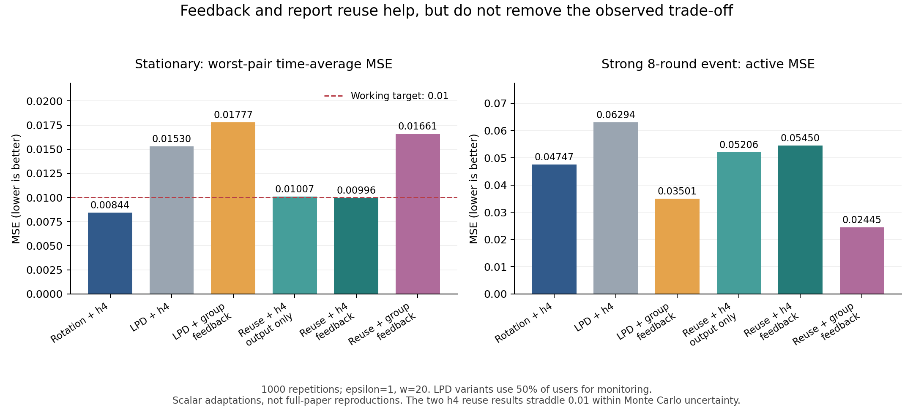

# 第十一次讨论：反馈平滑与报告复用后的误差验证

日期：2026-10-27。接续[第十次讨论](2026-10-26-第十次讨论-监测成本与最终发布误差验证.md)。

## 1. 这轮结论，以及它改变了什么

**反馈平滑与报告复用都有局部收益，但本轮仍未验证出一个在稳定精度要求下优于轮换+h4/h5的自适应方案。**同时，不能继续把监测报告看作只能用于判断、必然不能用于估计的资源。

本轮实际完成：25种输出、7个场景、每场景1000次重复；另做临界稳定误差复核，以及9组单步合并估计的精确二项求和。代码和全部结果在[实验目录](analysis/2026-10-27-feedback-reuse/PROTOCOL.md)。

这是受限标量任务中的消融，不是完整MTSP-LDP、LDP-IDS或CAPP复现，也不是新算法。暂不扩大场景或拼装完整方案。

## 2. 对近期论文的核对

[MTSP-LDP原文](https://arxiv.org/html/2512.24899v1)的Algorithm 1、§3.4.2与§4.2.2给出分组平滑及其反馈关系。本轮提取均值分组规则作标量对照；零发布轮冻结组、变报告数的方差代理等约定明确记入协议。没有树、OBA和多任务查询，不能把这里的结果归到完整论文上。

[ICDE 2025 Dual Utilization原文](https://arxiv.org/html/2504.14993v1)的IPP/APP/CAPP利用用户端原值与历史扰动误差调整后续扰动，原文SMA含前后窗口。本轮服务器端合并已有报告不是CAPP，不能把两者混称“报告复用复现”。

本次补查发现两篇应进入后续阅读的近期论文：

| 论文 | 已核实范围 | 与当前问题的关系 |
|---|---|---|
| **Top-k Discovery Under Local Differential Privacy: An Adaptive Sampling Approach**，IEEE TDSC 22(2), 1763–1780，2025卷期；DOI含2024 | [作者机构记录与摘要](https://ira.lib.polyu.edu.hk/handle/10397/119087)确认ARBS/ARBSF涉及自适应采样、top-k与频率估计；全文入口本轮访问失败 | 必须核查其估计校正能否直接处理我们的选择问题；仅凭摘要不能说已覆盖或未覆盖 |
| **Privacy-Preserving Joint Distribution Analysis for Set-Valued Data via Local Differential Privacy**，IEEE TIFS 21，2026，DOI 10.1109/TIFS.2026.3654799 | [作者托管全文](https://cs.newpaltz.edu/~lik/publications/Yilin-Wang-IEEE-TIFS-2026.pdf)首页、§II-B及主要方法介绍：SVJDA处理集合值记录的两项共现频率，使用稀疏向量聚合 | 进一步排除“LDP下联合分布没人研究”的宽泛表述；其与变化数据流、滚动隐私会计的完整适配尚未验证 |

这次查重不是穷尽检索。上述论文不能直接作为“我们的空白已成立”证据，也没有在本轮运行。

## 3. 实验到底补了什么

沿用每对2800名用户、15对、总n=42000、ε=1、w=20；每用户任意20轮最多一次1比特RR报告。独立用户池分别负责监测和发布。监测占比为25%或50%用户额度，不能理解成同一个人的ε拆分。

目标仍为当前总体关联ρ_t，单属性边际不变；用户及跨时间记录独立。7场景为独立稳定对照，以及幅度0.2/0.6 × 时长2/8/持续。稳定误差取最差属性对的时间平均MSE，0.01只是沿用的工作目标。

主要消融分三层：

1. **终端平滑：**保持第十轮采集轨迹，只改变最后输出；包括固定窗口和分组。
2. **反馈平滑：**下一轮的监测评分参照上一轮平滑后的发布值，采集决策因而可能改变。
3. **监测报告复用：**已有监测报告也参与当前估计，再进行平滑；分别测试是否反馈。

复用时，监测人数r_m、均值Y，实际发布人数r_p、均值Z，先计算：

$$C=\frac{r_mY+r_pZ}{r_m+r_p}.$$

没有追加发布时r_p=0，仍可用监测估计。全部处理只访问已私有化报告；同一条报告用于判断和计算，不再次消耗隐私预算。实际采集仍受冷却账本限制。

分组只计入新采集的估计，无发布时不把复制旧值当作新独立观测。组内保留未截断值，输出截断[-1,1]；无未来数据，也不回改历史输出。分组阈值用方差代理，**不声称自适应分组无偏或必然降MSE**，特别是人数受当前报告影响的合并估计。规则及全部差异见[运行前协议](analysis/2026-10-27-feedback-reuse/PROTOCOL.md)。

## 4. 主要结果：改善了，但没有消除取舍

下表监测方法均为50%用户用于监测。动态指标为幅度0.6、持续8轮的事件；数字来自本轮独立种子，不能与上一轮逐点配对。

| 方法 | 稳定最大对MSE | 事件活跃期MSE | 归零后10轮MSE |
|---|---:|---:|---:|
| 全用户轮换+h4 | 0.00844 | 0.04747 | 0.03985 |
| LPD标量适配+h4，监测只用于决策 | 0.01530 | 0.06294 | 0.05673 |
| 发布组分组平滑，并反馈 | 0.01777 | 0.03501 | 0.04183 |
| 复用监测报告+h4，仅改终端输出 | 0.01007 | 0.05206 | 0.04369 |
| 复用监测报告+h4，并反馈 | 0.00996* | 0.05450 | 0.04511 |
| 复用监测报告+分组，并反馈 | 0.01661 | 0.02445 | 0.02612 |

**复用有效：**同一采集轨迹下，复用+h4相对原h4把稳定最大对MSE降低约34%，活跃期降低约17%。这不是追加隐私预算换来的改善。活跃期配对差的95%区间为[−0.01192,−0.00985]。

**反馈不是自动改善：**复用+h4加入反馈后，稳定点估计略低，但活跃误差从0.05206变成0.05450。后者比轮换+h4高约15%；独立均值差95%区间为[0.00595,0.00811]。

**响应快仍有代价：**复用+分组反馈把强8轮事件误差降至0.02445，比轮换+h4低约48%，却有0.01661的稳定误差。不能忽略这一代价，也不能把“更快响应”本身包装成新颖性。



全用户轮换也补了同样的标量分组对照：稳定MSE=0.02720，事件MSE=0.02485。说明所测分组规则本身就偏向快速响应，不能把全部变化都归因于动态分配。

### 临界达标不能只看一条小数

*对0.01007/0.00996专门补做原种子的逐对损失区间，以及独立seed=2026102712的1000次稳定复核。此项是在主结果后触发的诊断，已写入协议修订，没有重新调参数。

| 方法 | 主实验稳定点估计 | 主实验最大对均值的近似95%区间 | 独立种子点估计 |
|---|---:|---|---:|
| 轮换+h4 | 0.00844 | [0.00832, 0.00857] | 0.00845 |
| 复用+h4，终端 | 0.01007 | [0.00990, 0.01024] | 0.01007 |
| 复用+h4，反馈 | 0.00996 | [0.00978, 0.01014] | 0.00997 |

区间按每次重复的时间平均损失计算，对15个属性对作Bonferroni修正，再界定最大均值；是近似Monte Carlo区间，不是应用中的同时误差保证。两条复用结果的区间都跨过0.01，独立种子也如此。**目前不能确认反馈版稳定达标，终端版也不能简单定性为显著失败。**而事件误差差距并未随这条筛选线消失。

### 其他动态场景

| 幅度、时长 | 轮换+h4活跃MSE | 复用+h4反馈 | 复用+分组反馈 |
|---|---:|---:|---:|
| 0.2，2轮 | 0.02495 | 0.02983 | 0.03297 |
| 0.2，8轮 | 0.01270 | 0.01625 | 0.02453 |
| 0.2，持续前20轮 | 0.01015 | 0.01257 | 0.02050 |
| 0.6，2轮 | 0.15502 | 0.16407 | 0.04032 |
| 0.6，8轮 | 0.04747 | 0.05450 | 0.02445 |
| 0.6，持续前20轮 | 0.02333 | 0.02720 | 0.01848 |

25%监测和所有其他预设方法均保存在[主结果](analysis/2026-10-27-feedback-reuse/summary.csv)，没有隐藏失败方法。按稳定点估计筛选，6个动态场景活跃期最低点估计仍来自轮换+h4或h5；这不是“显著赢6组”的断言，也不代表全部算法或参数的最优性。

## 5. 新的具体误差证据：追加人数依赖监测值，合并就不再是普通固定样本平均

为隔离原因，固定当前总体关联ρ、已实现历史H；先收70条监测报告，再按同一校正评分决定是否收140条新报告。对两批二项分布直接枚举，得到未截断合并估计C的精确均值与MSE。这是结果后的单步诊断，非完整算法误差归因。

例如真实ρ=0.6、历史H=0：

- 合并估计的期望是**0.56125**，偏差约−0.03875，而不是0.6。
- 实际MSE是**0.04048**，实际方差约0.03897。
- 若直接使用固定人数公式κ⁻²/(r_m+r_p)，再取平均，只有**0.02889**，此时连实际方差也低估。

原因可写成一个条件期望。令A(Y)表示本轮是否追加采集，a(Y)=r_m/[r_m+A(Y)r_p]，由于新发布报告独立于监测报告：

$$E[C\mid Y]=a(Y)Y+[1-a(Y)]\rho,$$

因此偏差为E[a(Y)(Y−ρ)]。权重与Y有关，不能把它从期望里拆出去。隐私后处理仍然成立，但常规独立固定样本数的无偏性或方差公式不会自动成立。

这并不意味着应该无条件追求去偏。例如ρ=0.2、H=0，合并估计有约−0.05154偏差，但MSE=0.03608；同平均报告数、与监测值无关的随机追加对照无偏，MSE却为0.05251。另一个ρ=0.6、H=0例子中，该随机对照MSE=0.02667，反而低于自适应合并。随机对照只用于匹配平均通信的分析，不是推荐的在线策略。

**我们真正要控制的是最终MSE，而非把“出现偏差”直接变成创新理由。**这类选择依赖是已知统计现象；本轮把它接到了数据流隐私采集和报告复用的具体环节。

## 6. 隐私资源和实现核查

强8轮场景、50%监测时，原采集每对每轮平均124.69条报告；发布组分组反馈123.92条；复用+h4反馈123.86条；复用+分组反馈123.98条。全用户轮换为140条。相同上限不意味着相同实际消耗。

终端复用共享原采集，额外报告数为0。所有模拟路径滚动总人数不超过2800，发布组人数不超过1400；检查了一条显式用户ID冷却实现。隐私依据仍是分离用户池、任意20轮单用户最多一次ε报告、决策仅用私有输出；人数检查辅助结构论证。

实现核查还包括：两种alpha下原采集分支与第十轮相同输入及种子逐点一致；等方差分组与直接公式一致；未采集时不增长组。9组选择诊断分别用条件矩与71×141个联合二项格点求和核对，差异小于6×10⁻¹⁴。

## 7. 当前问题应如何收紧

“要不要花隐私预算做监测”不宜再被表述成只能二选一；同一私有报告可以同时用于决策和估计。现在更具体的待核查问题是：

> 在w-event LDP的数据流中，同一批扰动报告既决定追加采集，又进入当前统计估计时，能否可靠评估最终发布MSE，让预算/人数决策的收益真正超过固定轮换？

这个问题与用户主线直接相关：约束是持续隐私预算，研究对象是决策后的估计误差。但它仍不是确认空白，本轮没有找到新算法、普遍下界或完整论文缺陷。

下一步先做最小的理论与查重核查：

1. 对上述单步选择规则，检查已有序贯估计、选择后风险评估、TDSC 2025自适应采样校正是否能直接给出可用处理；先查普通方法，不引入整套新机制。
2. 处理的评判必须是相同隐私/通信约束下的最终MSE，不能仅因无偏就认为更好；继续保留轮换+h4/h5。
3. 若现成处理解决了该环节，应降低或淘汰这个切口；若仍留下与w窗口持续反馈直接相关的困难，再讨论它是否是可研究的问题。

不再围绕0.01反复调参，不把有限模拟中一个方法未达标当作存在创新空间的证明。完整近期论文与真实应用验证仍未完成。

## 8. 文件与复现

- [运行前协议及结果后补充](analysis/2026-10-27-feedback-reuse/PROTOCOL.md)
- [主脚本](analysis/2026-10-27-feedback-reuse/run.py)、[补充诊断](analysis/2026-10-27-feedback-reuse/audit.py)、[绘图脚本](analysis/2026-10-27-feedback-reuse/plot.py)
- [175行主结果](analysis/2026-10-27-feedback-reuse/summary.csv)、[均值差区间](analysis/2026-10-27-feedback-reuse/comparisons.csv)、[资源诊断](analysis/2026-10-27-feedback-reuse/resource_diagnostics.csv)
- [最大稳定误差区间](analysis/2026-10-27-feedback-reuse/stationary_max_intervals.csv)、[逐对区间](analysis/2026-10-27-feedback-reuse/stationary_pair_intervals.csv)、[9组精确选择诊断](analysis/2026-10-27-feedback-reuse/exact_selection.csv)

从仓库根目录依次运行：

```powershell
python paper-ideas/analysis/2026-10-27-feedback-reuse/run.py
python paper-ideas/analysis/2026-10-27-feedback-reuse/audit.py
python paper-ideas/analysis/2026-10-27-feedback-reuse/plot.py
```

本轮推进到：已补反馈与复用消融，临界稳定误差没有被夸大；发现并精确核实了报告选择与最终估计耦合的误差现象。下一步是检验现有理论是否足够，而非立即宣称新课题成立。
