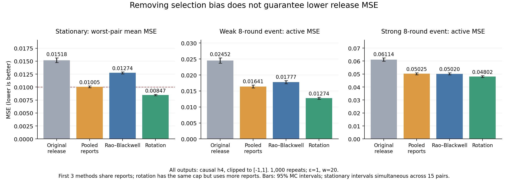

# 第十二次讨论：选择偏差校正的现成方法与创新性核查

日期：2026-10-28。接续[第十一次讨论](2026-10-27-第十一次讨论-反馈平滑与报告复用后的误差验证.md)。用户要求：继续验证能否作为创新点，仍以数据流、隐私预算和最终估计误差为主线。

## 1. 本轮判断

**不建议把“同一私有报告参与采样决策和最终估计，产生选择偏差，再设法去偏”作为论文的核心创新。**它是需要正确处理的问题，但当前二元随机响应模型可直接应用经典 Rao–Blackwell 条件化，无需额外隐私预算或报告。

本轮完成了文献核对、可计算公式、351组精确枚举，以及3个流式场景各1000次重复。结论比上一轮更明确：

- 偏差确实存在；但“发现这种偏差”不是新问题，“在本模型去偏”也不足以形成新机制。
- 普通方法可以去偏；去偏不等于降低最终MSE，实验中有明显的方差代价。
- 加上w-event约束并没有阻止这个单步处理：给定过去历史，当前可用人数已知，现成条件化仍适用。
- 尚未验证出一个同时满足既定稳定精度、改善变化期误差的创新方法。本轮不能据此否定所有自适应预算研究，也不能反过来宣称还有一个已经确认的研究空白。

## 2. 文献查重：哪些已有人研究，哪些仍须区分

| 文献 | 本轮核实的内容 | 对选题的作用 |
|---|---|---|
| [Porcher & Desseaux, 2012, What inference for two-stage phase II trials?](https://link.springer.com/article/10.1186/1471-2288-12-117) | Methods式(6)用第一阶段无偏比例对最终阶段和总计数做Rao–Blackwell条件化；讨论去偏与MSE的差别 | 两阶段选择后估计已有明确工具。原文是单侧停止规则，下面是我们对双侧追加规则的直接推导，不声称照搬其UMVUE结论 |
| [Shin, Ramdas & Rinaldo, NeurIPS 2019](https://proceedings.neurips.cc/paper/2019/hash/65b1e92c585fd4c2159d5f33b5030ff2-Abstract.html) | 区分自适应采样、停止和选择导致的样本均值偏差 | 自适应采样后均值有偏不是新现象；未核对单调性前，不套用其偏差符号结论 |
| [Top-k Discovery Under LDP: An Adaptive Sampling Approach, TDSC 2025](https://ira.lib.polyu.edu.hk/handle/10397/119087) | 本轮已成功获取作者接受稿，阅读§4.4—4.5并渲染核对第7页。式(15)为RR仿射反演；Theorem 4.3以报告均值的期望关系推导无偏性，Algorithm 3给出ARBSF | 纠正上一轮“全文尚未获取”的状态。不能把其式(15)直接当作我们追加规则的选择校正，也不能用我们的不同规则宣布其算法/定理错误 |
| [MTSP-LDP，PACMMOD/SIGMOD 2026](https://arxiv.org/html/2512.24899v1) | §3.3的OBA已考虑过去w轮差异，以窗口误差代理选择发布次数和预算；Algorithm 2还受剩余预算上限约束 | 不能把“考虑长时段误差/滚动预算”本身当作没人做过的创新。进一步研究必须说明与其目标及保证的实质差别 |

TDSC论文DOI为10.1109/TDSC.2024.3471923，卷期为2025年3—4月，22(2):1763–1780；不是2026新录取论文。下载的接受稿页眉残留模板年份，不用于判断发表时间。[作者接受稿入口](https://ira.lib.polyu.edu.hk/bitstream/10397/119087/1/Du_Top-k_Discovery_Under.pdf)。仓库只保存阅读笔记和链接，不重新分发PDF。

早期统计论文用于查重；研究主线仍由2025—2026流式LDP工作确定。本轮不是穷尽所有近期录取列表的系统综述。

## 3. 为什么已有工具能直接覆盖我们的偏差

以下为我们对受限模型的推导。先给定过去全部私有历史F，包括历史发布H和当前候选追加人数r。监测人数m也在当前报告到来前确定。两批新用户的当前记录独立同分布，每条使用相同ε的二元RR；各轮记录独立，允许总体关联ρ_t随时间变化。

记κ=tanh(ε/2)，私有报告取正号的概率p=(1+κρ)/2。第一批正号数X服从Bin(m,p)，无偏监测估计为

$$Y=\frac{2X/m-1}{\kappa}.$$

沿用上一轮的追加事件：

$$A(X)=\mathbf1\left\{(Y-H)^2-\frac{\kappa^{-2}-Y^2}{m-1}>\frac{\kappa^{-2}}r\right\}.$$

r=0时不追加。如果A=1，再收集Z~Bin(r,p)；否则不收集。令实际人数N=m+Ar、实际总正号数S=X+AZ。按实际人数直接合并C=(2S/N−1)/κ，可能有偏，因为N依赖X。

现成处理是：

$$\widehat\rho_{RB}=E[Y\mid N,S,F].$$

不追加时N=m、S=X，所以结果就是Y。追加时，给定S后，第一批计数的条件概率为

$$\Pr(X=x\mid N=m+r,S,F)=
\frac{\binom m x\binom r{S-x}\mathbf1\{A(x)=1\}}
{\sum_u\binom m u\binom r{S-u}\mathbf1\{A(u)=1\}}.$$

求和只遍历可行计数。两批计数联合概率中的p^S(1−p)^(m+r−S)是共同因子，被约去；因此**部署计算不需要知道真实ρ**。使用这些权重计算X的条件均值，再代入Y即可。

由条件期望与条件方差分解：

$$E[\widehat\rho_{RB}\mid F]=\rho_t,\qquad
E[(\widehat\rho_{RB}-\rho_t)^2\mid F]\le E[(Y-\rho_t)^2\mid F].$$

右侧比较对象是只用第一批的Y，**不是已经合并两批的C**。这不保证RB比C的MSE更小，也未证明它是所有无偏估计中最优的UMVU。

隐私上，它只重新计算已经私有化的计数，未接触新原始数据；原采集账本不变。即使r由过去的滚动预算和历史报告决定，给定F以后仍可计算。因此，“把单步偏差搬到w-event流中”并不会自动获得新颖性。

边界：当轮两批总体不一致、用户选择依赖当前未扰动值，或跨时间相关性使新记录在给定历史后不再符合上述二项模型时，不能直接套用。本轮不通过新增这些条件来维护选题。截断到[-1,1]及对多轮做h4平均后，不再声称对当前ρ_t无偏；后者在变化时仍有滞后。

## 4. 精确验证：去偏成立，但误差不必改善

[运行前协议](analysis/2026-10-28-rao-blackwell/PROTOCOL.md)与[完整实现](analysis/2026-10-28-rao-blackwell/run.py)。本轮无结果后调参。

- 复核上一轮9组，并扩展342组：m∈{35,70}，r∈{35,140,700}，H∈{−0.6,0,0.6}，ρ从−0.9到0.9，共19点。
- 精确求和两批二项计数；351组未截断RB的最大绝对偏差为3.11×10⁻¹³，均满足MSE不大于监测Y。
- 使用独立的超几何PMF实现检查条件均值，最大差4.73×10⁻¹³。与上一轮普通合并的精确结果最大差5.18×10⁻¹⁴。
- 数值精度与上面的解析推导一致；有限网格本身不是普遍证明。

取m=70、r=140、ε=1、H=0，两种代表性结果如下（未截断、无模拟置信区间）：

| 真实ρ | 普通合并偏差 | RB偏差 | 普通合并MSE | RB MSE | 解释 |
|---|---:|---:|---:|---:|---|
| 0.2 | −0.05154 | 数值上0 | 0.03608 | 0.05546 | 消除了偏差，但MSE增加约54% |
| 0.6 | −0.03875 | 数值上0 | 0.04048 | 0.03675 | 此时去偏同时降低MSE约9% |

因此不能用“估计量无偏”代替“隐私预算使用得更有效”。数据：[9组](analysis/2026-10-28-rao-blackwell/exact_selection.csv)、[342组](analysis/2026-10-28-rao-blackwell/exact_grid.csv)，均另列截断后的偏差与MSE。

## 5. 流式验证：没有出现足以支撑创新的最终收益

ε=1、w=20、42000用户、15属性对、240轮，预热40轮；每场景1000次。监测每对每轮70人，追加池1400人，严格沿用上一轮raw控制器。RB只改终端估计，**不反馈改变采集**；先隔离去偏的效应。

每用户任意连续20轮最多发送1条ε=1的报告；50%指用户额度分给监测，并非把同一用户ε拆成两份。

所有h4均为固定、因果的最近4轮平均，再截断。比较同一采集路径上的原发布、普通合并、RB；轮换使用独立报告。前3者隐私支出、实际报告完全相同；轮换满足同样资源上限，但实际每轮140条，前3者平均约124.65—124.70条，不能称实际报告量相等。

| 最终输出 | 稳定场景最大属性对MSE | 弱变化活跃期MSE | 强变化活跃期MSE | 强变化结束后10轮MSE |
|---|---:|---:|---:|---:|
| 原发布+h4 | 0.01518 | 0.02452 | 0.06114 | 0.05666 |
| 普通合并+h4 | 0.01005 | 0.01641 | 0.05025 | 0.04373 |
| RB去偏+h4 | 0.01274 | 0.01777 | 0.05020 | 0.04416 |
| 全用户轮换+h4 | 0.00847 | 0.01274 | 0.04802 | 0.03901 |

弱/强变化幅度分别0.2/0.6，均持续8轮。稳定列来自单独的稳定场景，非动态场景中挑出的低误差时间。误差对象都是当前总体关联。

关键区间：

- RB稳定最大均值的15对同时近似95%MC区间为[0.01255,0.01293]，高于0.01工作门槛。普通合并为[0.00988,0.01023]，仍不能确认临界达标；轮换为[0.00834,0.00859]。
- 强变化活跃期，RB−普通合并的配对差为−0.000047，95%MC区间[−0.000365,0.000272]，**没有可靠改善**。
- RB在强变化后最初10轮（post10）比普通合并低0.00096，但活跃8轮内无可靠差异、结束后的return10误差反而较高。不能只选有利指标。
- 强变化活跃期，RB−轮换的独立差为0.00218，区间[0.00108,0.00328]；在本模型和资源上限下仍较差。

全部结果：[summary.csv](analysis/2026-10-28-rao-blackwell/summary.csv)、[配对/独立差](analysis/2026-10-28-rao-blackwell/comparisons.csv)、[稳定区间](analysis/2026-10-28-rao-blackwell/stationary_intervals.csv)、[资源](analysis/2026-10-28-rao-blackwell/resource_diagnostics.csv)。代码检查所有模拟路径的滚动人数上限，并显式核对一条用户ID调度；原raw采集与上一轮同种子逐元素一致。[验证记录](analysis/2026-10-28-rao-blackwell/validation.csv)。

本实验只检验3种预设场景及终端处理，未排除其他估计器、反馈规则或完整论文方法；不是自适应方法的一般劣势证明。

## 6. 这个切口现在该如何处置

| 表述 | 当前判断 |
|---|---|
| 首次发现自适应采集与报告复用导致估计偏差 | 淘汰：一般现象已有研究 |
| 提出一个不额外花隐私预算的单步去偏公式 | 不足以独立成创新：经典条件化直接可用，且不需要新隐私机制 |
| 去偏后必然提升持续发布精度 | 不成立：理论没有这种保证，本轮最终MSE也未支持 |
| 滚动预算下，怎样选择采集和发布以降低最终累计误差 | 与用户方向一致，但仍须查重；MTSP-LDP已研究窗口误差预算优化，不能重新命名就当创新 |

**当前应停止围绕“如何去掉这一偏差”继续堆实验。**已经得到可复用的统计基线和明确的淘汰理由。

如果继续推进预算与误差主线，下一步只核查一个更窄的问题：**在已有报告允许复用、采集决策会改变后续可用隐私资源的条件下，现有窗口误差代理能否正确比较两个可执行策略的最终累计MSE？**先严格对齐MTSP-LDP/OBA实际目标、预算会计和反馈估计器；“回看窗口代理”与“可执行策略风险”的不同是待分析区别，不是本轮已证明的论文缺陷。

判断标准：若已有统计与预算方法直接覆盖，应继续淘汰；若只能在我们简化模块上看到差距、不能定位原文假设或一般适用范围，也不足以立项。不继续围绕0.01调参，不凭“还有困难”宣称创新。本轮未确认完整课题，但已经排除了一个看似有希望、实际容易重复的核心表述。
