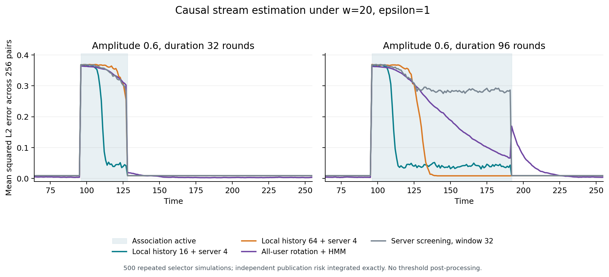

# 第十四次讨论：本地历史筛选的可行性与创新边界

日期：2026-10-29。接续[第十三次讨论](2026-10-28-第十三次讨论-预算代理与可执行策略的累计误差.md)。用户要求继续验证，直到找到一条创新点的路是可行的。

**本轮得到一条有正向证据的候选路线：利用用户设备上的短历史，先私有筛选稀疏关联，再把发布资源用于当前候选关联。窗口隐私可证明，独立种子与较强基线下出现最终MSE收益；但静态筛选方法已有论文，尚未证明流式扩展具有足够的新颖性。**不把“实验能跑通”写成“创新已经成立”。

## 1. 先明确我们提出的一个问题

> 同一批用户持续产生多属性记录，只有少量属性对有非零关联，关联的出现和持续时间未知。在w-event ε-LDP下，用户应当利用多长的本地历史来筛选关联，才能让有限报告预算降低当前关联统计的误差？什么时候历史积累的收益会被响应滞后及重复访问的隐私代价抵消？

这里“本地历史”是设备上尚未上传的原始记录，不是服务器保存的过去私有结果。区别很实在：过去的实验中，用户通常只上传当前某个属性对的一次扰动；现在检查用户能否先从自己的一小段记录判断哪个属性对更值得报告。

这是原来“数据流+差分隐私+未知关联”的延伸，主指标仍是**当前总体统计的最终MSE**。并非改做纯通信或一般变化检测。我们尚未选择论文最终题目，也没有声称解决了所有关联变化。

## 2. 哪些近期论文支持这个问题，哪些部分早已有人做

| 文献 | 已核实内容 | 对我们的约束 |
|---|---|---|
| [Rate Optimality and Phase Transition for User-Level Local Differential Privacy，JASA 2026](https://doi.org/10.1080/01621459.2026.2677739)；[作者预印本全文](https://arxiv.org/html/2405.11923v3) | §1.1设每用户持有来自同一分布的iid多条观测；§4.1.1/Algorithm6用部分用户本地选择、私有投票，其余用户估计筛选出的坐标 | 本地多观测、稀疏筛选、投票后估计都不是新发明。本文正式发表2026，预印本始于2024。它没有直接给出我们非平稳持续发布的窗口会计与当前风险保证 |
| [MTSP-LDP，PACMMOD/SIGMOD 2026](https://doi.org/10.1145/3786669)；[全文](https://arxiv.org/html/2512.24899v1) | 持续发布、私有差异判断、窗口预算优化、反馈平滑等已存在 | 不能把“按变化分预算”当新问题。本轮没有复现整篇方法，也没有证明本地历史路线胜过其完整实现 |
| [Better Locally Private Sparse Estimation Given Multiple Samples Per User，ICML 2024](https://proceedings.mlr.press/v235/ma24c.html) | 已有先本地选变量、再低维估计的用户级LDP框架 | 必须查重；不能因不属于2025—2026就忽略，更不能只换成属性对便声称创新 |
| [PPMCS，TIFS 2025](https://doi.org/10.1109/TIFS.2025.3574967) | 原始历史预测、预算预留、逐时刻回收额度均已有设计，详见第十三轮 | “使用历史”和“自适应预算”这些词不新；需要证明具体任务、会计和误差边界的实质区别 |

本轮检索还检查了“streaming sparse mean”“w-event batch/voting”“local history”等交叉词，未找到可确认直接解决上述完整问题的结果。**检索未命中不是不存在的证明。**TOSN关联流全文、一般私有在线稀疏估计和完整近期方法对照仍有缺口。

## 3. 为什么先前的单步去偏与预算预留没有继续作为主线

第十二轮发现经典Rao–Blackwell即可处理当前模型的单步去偏，而且未带来稳定的发布MSE收益。第十三轮发现代理风险不等于执行风险，但预测、预留、恢复时间也都已有对应工作。这些结果已保存，不能重新包装为创新。

本轮增加的是此前未实测的**信息使用位置**：在隐私扰动前，设备能利用多少本地历史来识别稀疏结构。这个机会有静态理论支持，但迁入持续变化的流会付出等待、过时信息与历史访问会计的代价。

## 4. 隐私验证：发送一次，不等于只影响一次

若一条报告访问此前b轮原始记录，某个输入时段的改变可能影响在该时段结束后发送的报告。因此仅检查“每w轮发送预算之和”不够。

已构造并运行一个精确小例子：w=4，在第2、6轮分别对最近3条记录的多数符号做ε=1的RR。任意4个发送时刻最多含一条报告；但改变输入第2—5轮可以使两条多数符号都翻转。观察两条都为+1的概率比为exp(2)，超过exp(1)。见[精确代码](analysis/2026-10-29-local-history/accounting_and_frontier.py)及[结果](analysis/2026-10-29-local-history/history_privacy_counterexample.csv)。这是基础组合反例，不是针对某篇论文的漏洞或新隐私定理。

本轮采用一个简单且保守的有效日程：每用户报告间隔

$$L=w+b-1,$$

每次只访问最近b条记录，并对整个b条记录的选择结果执行ε-LDP。相邻原始访问块之间有w−1个不访问时刻，因此任意长度w的输入改变区间最多碰到一块，全部转录满足w-event ε-LDP。相位公开分散给不同用户，服务器仍然每轮收到报告，不需要等全体用户凑齐。

一般固定间隔L、固定访问长度b下，一个长度w的输入区间最多影响

$$q=\left\lceil\frac{w+b-1}{L}\right\rceil$$

条报告；每条用a时，qa≤ε是一个充分组合条件，不声称必要或最优。b=64、w=20若仍每20轮用ε报告，组合上界会变成5ε；不能沿用当前值轮换的证明。我们的b16/b64日程分别L35/L83，枚举所有相位与改变区间确认最多一条受影响报告。隐私保证对任意输入成立，iid只是效用假设。

## 5. 实际实验：先筛选，最后仍看发布误差

先写[运行前协议及事后扩展记录](analysis/2026-10-29-local-history/PROTOCOL.md)，再跑首轮300次，随后用新种子跑加强基线500次，原结果都保留。

- n=20480，w=20，ε=1；256轮，每轮至多1个上行私有比特/用户。
- 256个候选属性对是公开星形工作负载(X0,Xj)，不是全部两两组合。构造X0均匀±1、Xj=X0 Sj，保证单属性边际不变、目标关联等于E[Sj]。
- 至多一个非零关联；所有方法知道这个稀疏先验，不知道位置、幅度、起止时刻。用户及时间之间独立。与前面6属性、42000人的实验不同，不混合排名。
- 6个事件场景：幅度.2/.6 × 持续8/32/96轮；另有全零与恒定.6稳定对照。
- 本地方法：一半用户用b16或b64条历史选绝对经验关联最大者，通过公开Hadamard行+RR发1比特；服务器聚合最近g1或g4轮投票。另一半用户每轮512人，独立估计所选属性对的当前值，其他对输出0。
- 同结构基线：服务器用当前值轮换报告筛选，比较h4/8/16/32/64/128；独立当前估计完全相同。另有全部用户轮换+稀疏后处理、恒零，以及更强的**全部用户轮换+因果HMM后验均值**。
- HMM允许无关联及一个带符号的关联，知道候选幅度集合（含生成幅度），转移率固定1/64；不知道变点。其全部20480人用于当前报告，本地两阶段方法的平均报告量更少。

本地方法额外使用设备存储和原始历史计算：b16平均约293条筛选报告/轮，加512条发布报告；全用户轮换1024条/轮。不能说所有资源相同。公共随机数/下行参数没有计入上行1比特。

对二阶段方法，我们模拟筛选的随机报告，再对独立发布的RR计数精确积分。这评估的是最终MSE，而非只测“选对了几个”；也不是生成了500条完整发布噪声轨迹。4组小模型完整枚举、6组各5万用户直接计数核查、Hadamard正交与通道比、全部历史访问日程核查均通过。

## 6. 加强基线后保留下来的正向证据

下面是第二轮500次的**事件期时间平均总MSE，即所有256对平方误差之和**，不是除以256后的平均，也不是第十三轮的累计20轮误差。均使用截断，尚未加后面的阈值处理。

| 情形 | 本地b16+服务器g4 | 全用户轮换+HMM | 判断 |
|---|---:|---:|---|
| 强度.6，持续8轮 | 0.36716 | 0.36428 | 没有收益；恒零为.36 |
| 强度.6，持续32轮 | **0.19294** | 0.34645 | 约降44.3% |
| 强度.6，持续96轮 | **0.09058** | 0.22076 | 约降59.0% |
| 强度.2，持续96轮 | 0.04887 | 0.04231 | 更差；恒零为.04 |
| 全零稳定流 | 0.00915 | 0.00370 | 本地方法仍有无用发布噪声 |
| 恒定.6稳定流 | 0.04141 | 0.04611 | 小幅更低；本地b64则为.00844 |

32/96轮强事件中，本地b16相对HMM的MSE差分别为−.15351、−.13018，Monte Carlo近似95%区间分别[−.15743,−.14959]、[−.13670,−.12366]。这是本合成模型内的模拟精度，不是真实场景保证，也不是全面多重比较后的获胜证明。

对固定服务器窗口也保留收益：强32轮其最小点估计约.34642；强96轮约.26269。HMM已经使用全部用户、较丰富的先验，仍未消除本轮这两个场景的差距。但这不能替代论文完整复现、最优后处理或普遍下界。

图中前8轮误差几乎没有改善。b64积累足够历史后更准确，但启动慢；b16更早降低误差，却有残余选错。长事件最后8轮的本地b16/b64总MSE分别.03928/.00844。这说明固定选择一种历史长度有明确代价。

事件结束后的本地误差迅速回到.00915，**不是它立刻忘掉旧关联**：b64仍可能投给旧属性对，只是另一批用户重新估计当前值为0。这个特例没有出现“新关联迁到另一对”的竞争，不能据此说历史失效问题已解决。

## 7. 普通阈值可以处理无关联时的无用发布，不能当创新

第二轮后固定公共α=.01，给独立当前RR估计加Hoeffding阈值τ=.31131，绝对值不足阈值时输出0。对所有二阶段server/local方法同样处理，不改变筛选、不增加报告。

二项精确求和得到全零流总MSE从.009146降到.000138；本地b16在强32/96轮事件的风险变成.18844/.08870。弱96轮仍约.04013，基本不优于恒零.04。这只补上一个简单后处理，不能说解决了弱变化检测。

这是**事后解析核查**：利用第二轮选对率加上精确条件发布风险，没有新独立试验或新的配对区间。α仅是单次空值概率上界，不能声称整条流误报控制。见[代码](analysis/2026-10-29-local-history/threshold_check.py)、[条件矩](analysis/2026-10-29-local-history/threshold_moments.csv)、[完整表](analysis/2026-10-29-local-history/threshold_check.csv)。

## 8. 为什么这条路线与预算—误差直接相关

设当轮选对概率为p，唯一非零关联为Δ；独立发布正确属性时的截断风险为r(Δ)，发布空属性时为r(0)。那么本轮二阶段方法的总风险为

$$R=p\,r(\Delta)+(1-p)\{\Delta^2+r(0)\}.$$

这是本模型的精确分解：选错的损失不是多一点噪声，而是把有限发布人群用于空属性，同时漏掉Δ。将本地原始历史用于筛选，有机会提高p；选择报告又受窗口隐私和可用用户数量限制。

本地b轮中只有k轮包含新关联时，候选统计的期望仅为kΔ/b。更长历史会稀释刚出现的信号。我们精确计算了本地选对率：M256、Δ.6时，b16的8/16轮活跃对应.03031/.27229；b64的8/64轮活跃对应.00939/.97361。后者稳定时很好，早期却几乎没有辨识力。

令本地索引投票概率差为γ=p_local−(1−p_local)/(M−1)，m条独立的一比特报告可用普通Hoeffding界得到服务器选错概率至多(M−1)exp(−mκ²γ²/8)，κ=tanh(ε/2)。这里m又约为g n_screen/(w+b−1)。这是保守充分界，不是必要界、新定理或已匹配下界；[精确局部概率表](analysis/2026-10-29-local-history/exact_local_frontier.csv)已保存。

由此可以明确分析三个量：**历史长度b如何提高/稀释信号，窗口隐私如何限制报告频率或单条预算，最终选错代价如何进入当前统计MSE。**这个具体关系比泛问“怎样动态分预算”更容易形成可检验的研究问题。

## 9. 创新性判定：哪一部分通过，哪一部分没有

| 检查 | 本轮状态 |
|---|---|
| 方向是否相关 | 通过：重复用户、w-event隐私、资源分配与当前关联MSE |
| 有无可执行且隐私合格的起点 | 通过：保守公开访问日程+已有私有筛选工具 |
| 是否仅弱基线才出现收益 | 有部分正向证据：独立种子与HMM复核后，强32/96轮仍有收益 |
| 是否所有场景有效 | 否：弱与短事件未解决；历史长度有取舍 |
| 是否新算法 | 否：本地筛选、私有索引、分组估计和阈值都已有基础方法 |
| 是否已经证明新问题未被解决 | 否：未完成全部近邻全文核查、近期完整算法复现和理论下界 |
| 是否值得保留研究 | **值得，作为目前优先候选；不等于已经足够投稿** |

最有希望继续争取的贡献，是**非平稳流中本地历史长度与窗口隐私的预算—误差边界，以及未知变化持续时间时对历史长度的合格选择**。如果最后只有“静态方法加一个滚动窗口”，创新性仍然不足，应停止。

## 10. 下一步的明确通过条件

1. **先核查竞争情形：**同一时间最多一个非零关联，但从属性对A迁移到B，且单属性边际不变。保持现有预算/阈值，检查旧本地历史是否使新关联长期得不到估计。不能再只用“消失到0”说明恢复快。
2. **补最接近的现成方法：**普通多尺度历史组合、私有报告上的标准在线筛选，以及静态用户级方法的直接滚动适配。若普通组合已足够，就不能以“自适应b”作为创新。
3. **理论目标先缩小：**给定M、n、w、ε和一段变化持续D，推导可以达到的当前风险/启动代价及适用边界，再考虑匹配下界。上面的Hoeffding界只能作起点。
4. **适用性门槛：**改变用户内时间相关程度、增加非零关联数、由星形扩展至全属性对，并选择真实多属性重复观测数据。当前iid和单关联特例不能外推。

继续研究时首先保留反对意见：本地多观测优势可能只是已有静态结果的预期延伸；我们需要证明持续变化和隐私会计之间产生了不可由普通拼接处理的实质问题。

## 11. 复现入口

- [完整代码](analysis/2026-10-29-local-history/run.py)，原始参数：`python run.py`；加强复核：`python run.py --stronger`。
- [首轮结果](analysis/2026-10-29-local-history/summary.csv)、[独立加强结果](analysis/2026-10-29-local-history/stronger-check/summary.csv)、[误差差值](analysis/2026-10-29-local-history/stronger-check/differences.csv)、[时间曲线](analysis/2026-10-29-local-history/stronger-check/time_curves.csv)。
- [本地选择概率核查](analysis/2026-10-29-local-history/kernel_checks.csv)、[隐私访问核查](analysis/2026-10-29-local-history/privacy_checks.csv)、[作图脚本](analysis/2026-10-29-local-history/plot_results.py)。
- 原始文献不上传到仓库；这里保存我们自己的分析、代码与合成结果。
