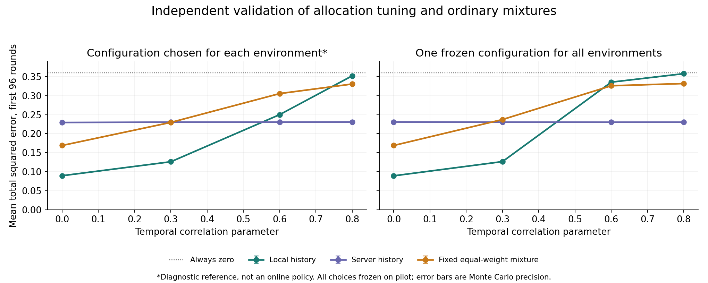

# 第十七次讨论：资源分配空间与固定混合验证

日期：2026-11-03。接[第十六次讨论](2026-11-03-第十六次讨论-时间相关性下的可行边界与创新问题.md)。

**结论：普通历史长度和人群比例调整已经能带来明显收益，因此这些调整本身不能当作创新。不同环境下合适的配置仍不同；本轮公平分人群的固定混合未自动解决取舍。有限策略族中存在可量化的环境适应空间，但尚未证明需要新机制，更没有证明这部分空间能被免费或低成本地实现。下一步优先排除“一次短期私有校准＋固定策略”这个简单办法。**

## 1. 这次真正验证了什么

第十六轮固定一半用户用于筛选，只试了16/64条本地历史。这不足以判断资源分配是否有价值，也不能排除普通参数调整。

这次保持N=20480、M=256个星形候选对、w=20、ε=1、关联强度.6，扩展为：

- 本地历史b=8/16/32/64/128。
- 服务器筛选窗口h=8/16/32/64/128。
- 筛选用户占25%/50%/75%，其余用户用于独立估计当前值。**调整的是采集人群分配，每个用户的ε仍为1，没有证明新的逐轮ε分配算法。**
- 时间相关λ=0/.3/.6/.8，恒定关联和A→B迁移两类环境；迁移前8/32/96、末8轮均保留。

共15种本地策略、15种服务器策略及25种普通固定混合。每种都保存原样/公共阈值输出；不把所有候选策略同时免费运行。平均上行比特数均不超过1024，但实际使用量不同。

[运行前协议](analysis/2026-11-03-allocation-grid/PROTOCOL.md)先于结果保存。探索每时刻300个快照，先选定配置，再用独立种子复核：迁移每时刻1500快照、稳定5000快照。另用第三种子验证“所有λ使用同一固定配置”。基础Markov内核沿用第十六轮，新增加74项核查。

这里仍是期望风险的快照积分，不是完整连续轨迹。研究目标是当前总体关联，不是已实现有限样本直方图；没有给出首次检测时延或全流误报结论。

## 2. 调完普通参数后，局面有没有改变

下表的配置均在探索集冻结，再独立验证。目标为迁移后前96轮、每轮全部256对的总平方误差，使用相同规则的公共阈值。比例指筛选人群占全体的比例。

| λ | 本地族选定配置 | 本地风险 | 服务器族选定配置 | 服务器风险 | 固定等权混合族风险 |
|---|---|---:|---|---:|---:|
| 0 | b16，50% | **0.08954** | h64，75% | 0.22940 | 0.16901 |
| .3 | b32，50% | **0.12626** | h64，75% | 0.23033 | 0.22966 |
| .6 | b64，75% | 0.25003 | h64，75% | **0.23041** | 0.30540 |
| .8 | b64，75% | 0.35195 | h64，75% | **0.23081** | 0.33050 |

混合族对应：λ0为b32+h64，其余为b64+h64。每个混合均按下节所述分人群。恒零风险为.36。

有三个具体更新：

1. **λ=.3时，b32比此前b64更合适。**风险从第十六轮约.170降到.126。上一轮只试16和64，遗漏了普通中间长度；不能把原结果当作历史长度难以选择的充分证据。
2. **服务器分配也需要认真优化。**把筛选比例从50%改为75%，四个λ下风险均约下降.030。λ=.6时差为−.03046，约95% Monte Carlo区间[−.03137,−.02954]。多筛选、少发布的普通分配在这里确实更好。
3. **优化以后，方法族仍有反转。**λ=.6时，选定本地策略比选定服务器策略多.01962风险，区间[.01893,.02031]；λ=.8时多.12114。不能只优化本地方案，然后和未优化的服务器对照比较。

表中的“族选定配置”不是全体算法最优，也不是已部署的自适应方案；挑选时使用了环境标签和探索实验的真值误差。

## 3. 稳定环境与迁移环境确实需要不同选择

在恒定环境，独立复核得到的本地/服务器风险如下：

| λ | 本地族选定配置 | 本地风险 | 服务器h128、50%风险 |
|---|---|---:|---:|
| 0 | b32，25% | **0.00570** | 0.04079 |
| .3 | b128，25% | **0.00783** | 0.04191 |
| .6 | b128，50% | **0.01140** | 0.03819 |
| .8 | b128，75% | 0.23106 | **0.04177** |

因此，第十六轮的“较强相关下本地方案变差”必须保留范围：对λ=.6的**恒定环境**，扩展到128条历史后可以重新获得优势。但新关联只持续96轮时，长历史仍会带着旧关联，不能将稳定优势直接搬过去。

也能看到独立复核的必要性：λ=.3稳定环境b128、25%的探索误差是.00563，复核变为.00783。不能把小样本探索中恰好没有选错的结果当作真实风险。

## 4. 普通固定混合：两套方法都要付出采集成本

混合方案将用户公开均分为两套独立子系统，每套10240人。每套再分5120人筛选、5120人发布，每轮发布256人。最后把两个稀疏估计向量等权平均，而不是每套各使用全体20480人。

两套私有发布的均值、二阶矩及交叉项都计入风险。特别是：

$$E\|v\widehat\rho_L+(1-v)\widehat\rho_S-\rho\|^2
=v^2R_L+(1-v)^2R_S+2v(1-v)C,$$

其中C是两套估计误差的内积期望。直接平均两个MSE并不等于平均向量的MSE。代码已用各20万次直接发布模拟检验双方选对、单方选对、双方选错同坐标/不同坐标等情况。

等权混合的主要代价有两个：每套筛选获得的人数更少；一套能找到新关联、另一套经常输出接近0时，平均会把信号压小。混合可能减少噪声，却不保证减少筛选错误带来的损失。

**不是只试了坏权重就作结论。**看过部分复核后，额外做了明确标注为事后探索的常数权重诊断：从同一批探索快照的风险恢复二次式，对所有25对(b,h)的v∈[0,1]解析最小化。四个λ等权目标下，阈值版最好的点估计为b32+h64、v≈.7425、风险.25852；仍高于探索集单一配置约.22741。

这一权重诊断没有独立复核，不能宣称普遍劣势；它只说明当前已尝试的半人群固定混合，并非把等权换成某个常数就明显胜出。其他人群比例、数据依赖权重、候选合并、不同编码都未被排除。

## 5. 不知道λ，只用一套固定配置行不行

为避免“每个环境单独挑最优”夸大可部署效果，再按探索集四个λ的前96轮风险等权平均，每个族只挑一套配置，用第三个种子冻结复核。

| 所有环境共用的固定配置 | 四λ等权平均风险 |
|---|---:|
| 本地b32、50% | **0.22727** |
| 服务器h64、75% | 0.23038 |
| 固定等权混合b32+h64 | 0.26599 |

等权是公开写明的实验诊断准则，不代表真实环境分布。固定本地b32的风险随λ为.08929/.12664/.33544/.35772；固定服务器方案则约.230，因此相近的平均数掩盖了非常不同的环境表现。

如果使用探索集预先冻结的环境特定选择——λ0/.3用本地，λ.6/.8用服务器——独立验证的四环境平均风险为.16926。与统一固定本地配置.22727相比，差约.05801，即约25.5%。

**这.05801是有限策略族中的诊断差距，不是我们已经实现的收益、免费适应保证或一般最优下界。**环境特定参照知道λ及评价场景，尚未支付学习环境、校验和切换的成本。真实在线方法可能只能缩小一部分差距，甚至没有净收益。

## 6. 不能将阈值损失全算作隐私预算损失

当前公共阈值随发布人数改变。对真实关联.6，已选对坐标时：

| 当轮发布人数 | 不加阈值的风险 | 加阈值的风险 |
|---|---:|---:|
| 768 | .00563 | .00563 |
| 512 | .00844 | .00866 |
| 256 | .01686 | .05446 |

只有256人时，阈值会额外把部分真实信号压到0，因此“多分用户给筛选”的代价包括发布噪声和所选后处理的影响。

去掉阈值重新选参、独立复核，λ0/.3/.6/.8本地族风险分别.07406/.11993/.24805/.36194；服务器约.22366/.22476/.22486/.22533。环境反转仍存在。四λ统一固定服务器风险.22482，环境特定参照.16104；不能认为全部取舍由阈值制造。

本轮公共阈值对应单次界，不是连续流整体误报保证。全部原样结果、全零精确风险、阶段结果都在CSV中。

## 7. 对创新判断的实际影响

现在支持的是一个更具体、可证伪的问题：

> **在未知环境下，为判断本地历史筛选是否值得使用而消耗的隐私采集资源，能否换来足够大的当前估计误差收益？能否控制这种判断和调整相对于合适固定策略的额外误差？**

本轮增加了两类证据：优化普通参数后仍存在方法选择差距；公平支付用户成本的普通固定混合未抹平差距。但不能由此直接声称新自适应机制必要。

**尤其不能跳过一次私有校准。**本轮每个场景的λ沿时间固定、各用户同分布。这可能使问题比真实流简单：用一小批用户或早期窗口私有估计历史的重复程度，然后固定选择一种配置，也许已经足够。若这个现成思路能填上主要差距，就不应把当前模型包装成需要复杂在线学习的新问题。

此前文献边界继续有效：[JASA2026](https://doi.org/10.1080/01621459.2026.2677739)及[ICML2024](https://proceedings.mlr.press/v235/ma24c.html)已有多观测用户下的本地稀疏选择；[NeurIPS2018](https://papers.neurips.cc/paper_files/paper/2018/hash/a01610228fe998f515a72dd730294d87-Abstract.html)已有演化数据的本地私有投票及更新。参数网格、样本分配、凸组合、二次风险最小化本身均不新。本轮没有声称这些论文无法适配，也没有新增“查无此文即证明空白”的判断。

## 8. 下一步只过一个关键关卡

先验证**短期私有校准＋固定策略**，与无需校准的强固定配置比较。

- 估计信息必须来自合格的私有报告，不能直接读取真实λ、真实关联位置或真实MSE来决定部署方法。
- 校准使用的人数、时间、报告及历史访问全部计入同一资源约束。校准数据与后续长历史可能重叠，不能只看发送时刻分开就认为没有重复隐私损耗。
- 用独立实验固定校准规则，既看选型正确率，也看支付校准成本后的迁移与稳定总风险。
- 预先统一整个数据流的评价目标；本轮稳定/迁移分别选参只是诊断，下一轮不能让校准器免费知道变化发生时刻或当前属于哪个评价阶段。
- 如果简单校准已足够，收缩当前创新判断；若仍有明确缺口，再核查标准序贯选择/在线风险方法，以及数据环境真正变化时是否还有可证明的研究价值。不得为维持选题随意添加难条件。

目前尚无新机制、一般上下界、真实数据或完整近期论文复现。可行的统计收益已经有证据，创新性仍需经过这个关卡。

## 9. 复现入口

- [协议及追加诊断说明](analysis/2026-11-03-allocation-grid/PROTOCOL.md)
- [主实验](analysis/2026-11-03-allocation-grid/run_grid.py)、[统一固定配置复核](analysis/2026-11-03-allocation-grid/confirm_global.py)、[事后常数权重诊断](analysis/2026-11-03-allocation-grid/weight_diagnostic.py)、[汇总及作图](analysis/2026-11-03-allocation-grid/analyze.py)
- [全部探索风险](analysis/2026-11-03-allocation-grid/pilot_summary.csv)、[冻结选参](analysis/2026-11-03-allocation-grid/frozen_choices.csv)、[选定配置的独立结果](analysis/2026-11-03-allocation-grid/selected_confirmation.csv)
- [复核差值区间](analysis/2026-11-03-allocation-grid/confirmation_differences.csv)、[统一固定配置汇总](analysis/2026-11-03-allocation-grid/global_equal_weight.csv)、[人数和通信](analysis/2026-11-03-allocation-grid/resources.csv)、[输出核查](analysis/2026-11-03-allocation-grid/output_checks.json)
- 先运行主实验，待探索文件完整后可运行统一配置复核；然后运行权重诊断及汇总。全部使用固定种子。下一次先读本页和[handoff](handoff.md)。
