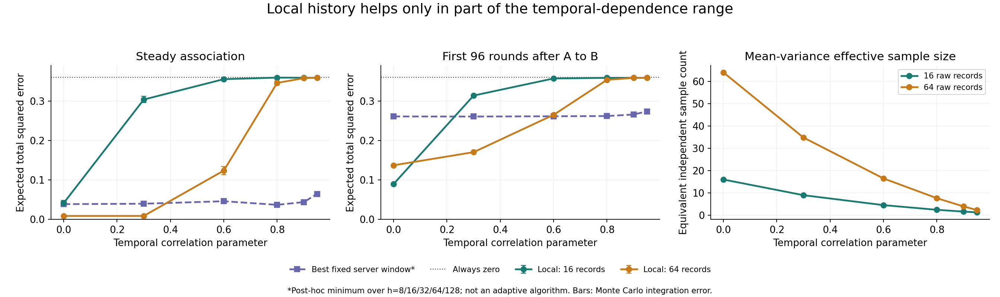

# 第十六次讨论：时间相关性下的可行边界与创新问题

开始于2026-10-30，续跑、分析及文献补查完成于2026-11-03。接[第十五次讨论](2026-10-29-第十五次讨论-关联迁移与多尺度资源代价验证.md)。

**本轮判断：此前的本地历史收益有适用条件，不能直接推广到一般相关数据流。正面证据是时间相关性不为0时仍存在明显收益；负面证据是相关性进一步增加后，固定本地历史方案会输给简单服务器方案。优先候选应收紧到“怎样判断历史筛选是否值得投入隐私采集资源，并控制这种判断及切换的最终误差代价”。已验证受限模型可行区间，尚未确认新算法或未被覆盖的理论贡献。**

## 1. 这次验证的是哪种“关联”

先区分两个层面：

- **属性间关联**：同一时刻的两个属性是否一起变化，是我们的目标。例如S_(u,j,t)=X_(u,0,t)X_(u,j,t)，总体ρ_(j,t)=E[S_(u,j,t)]。
- **时间相关性**：同一用户的S_(u,j,t)与前一轮S_(u,j,t−1)是否相似，决定历史记录能提供多少新信息。

原始±1属性和0/1表示可相互转换。这里延续星形属性对：257个二元属性，考察256对(X0,Xj)，不是任意所有两两组合。X0每轮均匀取±1、Xj=X0Sj，各单属性边际始终均匀。时间相关性施加在交叉符号S上；并不是宣称所有单属性自身都有同样的自相关系数。

前两轮把每个用户不同时刻的S设为独立。这次增加λ=0/.3/.6/.8/.9/.95；在目标关联恒定的区间，相邻交叉符号相关系数正好为λ。每时刻目标ρ保持原样，迁移时不会偷偷变成缓慢变化。具体二状态Markov转移在[运行前协议](analysis/2026-10-30-temporal-dependence/PROTOCOL.md)和[代码](analysis/2026-10-30-temporal-dependence/run_dependence.py)中。

隐私仍为w=20、ε=1的w-event LDP。时间相关性影响效用，不使基于任意固定输入序列证明的隐私保证自动失效；这也不等于保护整条无限轨迹或所有相关秘密的更强保证。

## 2. 实验如何保证可比较

沿用20480用户、关联强度.6、最多一个非零关联，公开固定一半用户筛选、一半估计当前值，每轮当前发布512人。

- 本地方案：最近16或64条原始记录选一个候选，私有索引投票，服务器聚合4轮；单用户报告周期分别35、83轮。
- 服务器方案：每用户间隔20轮报告当前符号，服务器使用最近8/16/32/64/128轮做筛选，然后同样独立估计当前值。
- 保留所有方案的原样输出、相同公共阈值输出，以及恒零输出。实际通信量不相等：本地16/64平均每轮约804.57/635.37比特，服务器1024比特；满足相同上限，不声称完全同用量。
- 两种环境：恒定关联；旧A在96—159轮活跃，160轮转为新B并持续96轮。迁移的前8/32轮只是共同轨迹的前缀，不包含分别结束后的恢复过程。

本地计数改用Markov动态规划。服务器窗口超过20轮会重复访问同一用户，也使用20步转移和RR发射分布计算，不将这些报告误当独立。当前发布人群与筛选人群独立，可以对发布噪声做精确二项积分。

每个目标时刻独立模拟1000次筛选快照，再平均各时刻的期望风险。**这能估计时间平均期望MSE，但不是1000条完整流轨迹，不能据此估计首次发现时延、连续漏检概率或全流误报率。**86项核查通过，包括小链全枚举、IID回归、原始Markov记录模拟、重复用户RR计数、均值/方差及隐私历史访问。10月30日运行中断，仅留下检查结果；11月3日以原参数原种子完成重跑。

## 3. 关键结果：可行，但不是所有相关程度都可行

指标为迁移后前96轮、每轮全部256对的平方误差之和，再取期望和时间平均。下表采用相同公共阈值，越小越好。

| 时间相关参数λ | 本地16条历史 | 本地64条历史 | 服务器h64 | 恒零 |
|---|---:|---:|---:|---:|
| 0 | **0.08949** | 0.13701 | 0.26071 | 0.36000 |
| .3 | 0.31365 | **0.17025** | 0.26052 | 0.36000 |
| .6 | 0.35699 | 0.26486 | **0.26119** | 0.36000 |
| .8 | 0.35846 | 0.35350 | **0.26178** | 0.36000 |
| .9 | 0.35854 | 0.35846 | **0.26562** | 0.36000 |
| .95 | 0.35866 | 0.35858 | **0.27367** | 0.36000 |

h64在本轮各λ的这一阶段都是预设服务器窗口中最低的点估计；表中是一个固定窗口，不是知道最优参数的在线自适应算法。

λ=.3时，本地64条相对服务器h64的风险差为−.09027，约95% Monte Carlo区间[−.09126,−.08927]，相对下降约35%。λ=.6时风险差反为+.00367，区间[.00256,.00479]。这些区间说明本合成模型内数值积分的精度，不是普遍优劣或真实流泛化保证。

去掉公共阈值，λ=.3时本地64/服务器h64为.17427/.26691；λ=.6时为.27137/.26760。因此反转不是仅由阈值造成的。

另外两个边界同样要保留：

1. **短事件仍然没解决。**迁移前8轮各本地方案风险约.359—.360，与恒零.36接近；不能当作及时发现成功。
2. **评价区间会影响判断。**λ=.6时，迁移最后8轮本地64风险.12153，优于服务器最好窗口h128的.16230；但前96轮平均仍输了。不能只展示适应完成后的好结果。

恒定环境中，本地64在λ=0/.3时风险.00866，在λ=.6时升至.12359，λ=.8时升至.34573；对应服务器h128为.03854/.03959/.04592/.03678。稳定环境只有一个时刻的1000次积分，服务器相邻λ间小幅非单调可能受Monte Carlo误差影响，不解读成结构规律。

## 4. 为什么“多存一些记录”不必然有效

在本轮平稳二状态链中，均值方差对应的有效样本量是

$$b_{\rm eff}=\frac{b}{1+2\sum_{k=1}^{b-1}(1-k/b)\lambda^k}.$$

这只是标准方差计算，不是新理论。64条历史在λ=.6/.8/.95时分别约等于16.48/7.64/2.32条独立观测的均值信息。

同时有三个不同数量：

1. **存了多少条**：决定存储、计算。
2. **跨了多少时间**：决定旧关联污染，以及当前保守日程下报告周期L=w+跨度−1。
3. **有多少有效信息**：影响本地能否从256个候选中选对。

第三项增加，不保证前两项的代价值得。尤其不能直接把b_eff代入IID高维筛选公式：均值方差相同不意味着最大值竞争的尾概率相同。本轮直接计算完整计数分布，没有这样替代。

这里L=w+跨度−1是我们当前协议的充分会计规则，不是所有机制的必要下界；换设计可能有更细的会计。不能把它包装成已证明的普遍不可能性。

## 5. 普通间隔抽样有没有直接解决

在主实验结果产生前补记协议，再做稳定段诊断：连续16条；每4轮取1条、共16条、跨61轮；连续64条。后两者报告周期分别80和83，不能让跨61轮的样本仍享有连续16条的35轮周期。每项10000次私有筛选快照。

| λ | 连续16条 | 间隔16条（跨度61） | 连续64条 |
|---|---:|---:|---:|
| 0 | 0.04043 | 0.18363 | **0.00866** |
| .3 | 0.30281 | 0.18865 | **0.00866** |
| .6 | 0.35705 | 0.28619 | **0.12426** |
| .8 | 0.35817 | 0.35114 | **0.34520** |

表中是同一公共阈值下最终风险。在λ=.6时，间隔抽样确实把16条记录的均值有效样本量从4.53提高到12.53，但未超过连续64条；λ=0时，本地原始胜出概率都约.27229，间隔方案却因报告人数减少，将服务器正确选择概率从.9096降到.5022。

因此，**常规间隔抽样有帮助，但本轮没有自动解决资源取舍**。这只是一个预设间隔在稳定段的比较，不证明所有间隔或去相关方法都失败，也没有补上迁移实验。

## 6. 文献支撑和查重边界

以下是支持问题定位及限制创新声称的文献，不是“这些论文共同证明我们的问题无人解决”。

| 文献与核查位置 | 已有内容及对我们的约束 |
|---|---|
| [JASA 2026：Rate Optimality and Phase Transition for User-Level Local Differential Privacy](https://doi.org/10.1080/01621459.2026.2677739)，[预印本§1.1、§4.1.1](https://arxiv.org/html/2405.11923v3) | 多观测用户模型、本地稀疏选择和私有汇聚已有理论；原始预印本2024。不能把本地积累记录后筛选本身当创新。当前逐时刻、非平稳目标不能直接套其IID结论。 |
| [WWW 2025：Local Differentially Private Release of Infinite Streams With Temporal Relevance](https://doi.org/10.1145/3696410.3714619)，[作者机构记录](https://researchers.mq.edu.au/en/publications/local-differentially-private-release-of-infinite-streams-with-tem/) | SPPA已考虑无限流的时间关系，使用Fourier插值及采样周期扰动，并定义带τ的时间隐私概念。本轮核实正式发表和摘要，并阅读公开投稿稿的导论/定义；未复现完整方法。“时间相关＋LDP”显然不是空白，且不能忽略隐私定义差别直接比较。 |
| [Differential Privacy with Dependent Data（2025预印本），§6](https://arxiv.org/html/2511.18583v2#S6) | 已把相关观测的均值估计扩展到本地模型，采用log-Sobolev依赖条件。因此“考虑相关性、改有效样本量”不能独立立项。根据[作者主页](https://sites.google.com/site/marcoavellamedina/research)，核查时仍列为submitted，不称其顶刊录用。 |
| [NeurIPS 2018：Local Differential Privacy for Evolving Data](https://papers.neurips.cc/paper_files/paper/2018/hash/a01610228fe998f515a72dd730294d87-Abstract.html)，[论文§1.1](https://proceedings.neurips.cc/paper_files/paper/2018/file/a01610228fe998f515a72dd730294d87-Paper.pdf) | 已使用每用户多个轮次组成epoch，研究变化数据的私有投票与更新、频率/重频项，以及epoch长度取舍。虽不在近两年，属于必须排除的已有方法。不能声称“本地历史＋变化触发”首次提出；应继续核对其epoch平均目标与我们的当前目标及w-event会计如何对应。 |

还需保持第十三至十五轮已有边界：MTSP-LDP已有窗口预算优化；PPMCS已有预测/预留/回收；ICML2024已有先选变量再估计。仅组合这些组件不构成新贡献。本轮检索未建立穷尽性，也未证明上述方法无法适配。

## 7. 现在最值得验证的具体创新问题

> **在关联位置会变化、用户历史存在重复信息的数据流中，怎样在w-event LDP下判断“继续用历史做本地筛选”是否值得，把有限采集资源分给历史筛选和当前估计，使迁移阶段与稳定阶段的最终MSE都得到控制？**

这和用户要研究的预算、误差直接对应：给筛选更多用户/预算，候选可能选得更准；当前估计可用的用户/预算却减少。历史变长可能增强识别，也会带入旧关联、扩大访问跨度、降低本协议的报告频率。仅优化本地判断准确率是不够的。

在本轮单非零关联、独立当前发布的设定下，可将目标写得很具体：

$$R_t=\pi_t r_{\Delta}+(1-\pi_t)(\Delta^2+r_0),$$

其中π_t是**经过私有投票后**服务器选对当前关联的概率，r_Δ/r_0是当前发布机制估计非零/零关联的风险。这个分解是基本条件期望，不是新理论。资源分配必须同时改变并评估π_t和发布风险，不能只让某个代理指标下降。

有希望进一步形成的贡献，是给出**何时值得利用本地历史的预算—误差边界，并用成本可控的私有决策接近该边界**。支撑来自两类实测：确有收益区间；最合适的采集方式随时间相关程度和事件阶段改变。

但这目前仍是**研究命题**：

- 已成立：受限模型中的正向收益及反转；常规双尺度/并集/单个间隔抽样未自动解决。
- 未成立：所有标准办法均失败；切换决策能以低成本实现；存在可发表的新上界/下界或算法。
- 不应声称：λ=.6是普适阈值；本地历史一般优于服务器；观察到失败就等于找到创新点。

## 8. 下一步怎么让它更接近可发表贡献

1. **先查是否有足够优化空间。**在预设历史长度和筛选/发布人群比例网格下算最终风险，得到有限策略族的理想参照；使用真值挑选的曲线只作诊断，不能列为合格私有方法，也不是一般最优下界。当前实验比例固定一半，尚未真正优化资源分配。
2. **先试现成自适应方法。**固定混合、分阶段选择、标准多尺度风险比较都需计入采集和选择成本。不能同时免费拿到所有候选策略的全人群私有报告；切换后的原始历史访问需重新核算w-event隐私。
3. **再定创新是否成立。**若普通方法已足够，把它们列为解决方案而不强行包装新算法；若有可复现的缺口，再研究额外误差界或新决策。继续核对NeurIPS2018、JASA2026及MTSP-LDP的完整算法，并补真实数据、多非零关联和完整时间轨迹。

## 9. 复现与交接

- [运行前协议与11月3日补充](analysis/2026-10-30-temporal-dependence/PROTOCOL.md)
- [主代码](analysis/2026-10-30-temporal-dependence/run_dependence.py)、[间隔抽样核查](analysis/2026-10-30-temporal-dependence/thinning_check.py)、[作图代码](analysis/2026-10-30-temporal-dependence/plot_results.py)
- [完整阶段风险](analysis/2026-10-30-temporal-dependence/summary.csv)、[与各服务器窗口之差](analysis/2026-10-30-temporal-dependence/differences.csv)、[逐时刻选择率](analysis/2026-10-30-temporal-dependence/time_curves.csv)
- [间隔抽样结果](analysis/2026-10-30-temporal-dependence/thinning_check.csv)、[86项核查](analysis/2026-10-30-temporal-dependence/kernel_checks.csv)、[元数据](analysis/2026-10-30-temporal-dependence/metadata.json)
- 下次先读本页和[handoff](handoff.md)。不要从“本地历史已普遍有效”继续推导，也不要把本轮称为完整近期论文复现。
