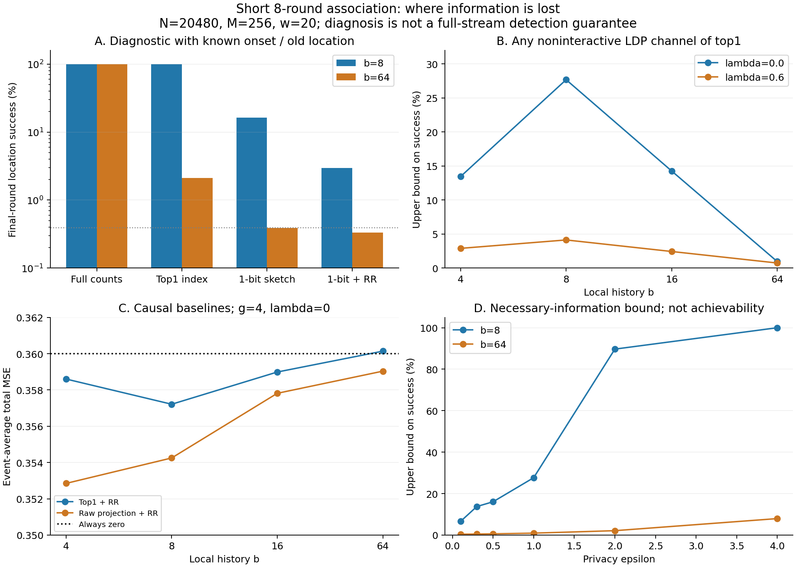

# 第十九次讨论：短暂新关联的信息损失与受限机制界

日期：2026-11-04。接[第十八次讨论](2026-11-04-第十八次讨论-一次私有校准是否足够.md)。

**本轮进展：把“短事件没估准”分成了可检查的三层损失，并得到一个仅针对top1摘要机制类别的解析限制。已知新位置时，当前值估计风险只有.00866；不知道位置时，现有方法仍接近恒零.36。原始计数确实含有定位信息，但长历史的第一名摘要以及之后的私有传输会丢掉很多信息。普通原始向量投影略有改善，仍没解决8轮短事件。因此已经找到具体瓶颈，但还没有证明存在足够新的、有效绕开它的路线。**

## 1. 这轮究竟跑了什么

固定N20480、M256个星形属性对、w20、ε1、关联强度ρ=.6；一半用户筛选，另一半每轮512人估计选中对的当前值。A在96—159轮活跃，B在160—167轮活跃，之后消失。单属性边际仍不变。

测试本地历史b=4/8/16/64，服务器聚合g=1/4/8；λ=0主实验、λ=.6补充。b控制本地读取的历史，g控制服务器汇集多少轮报告，两者不同。周期L=w+b−1计入重复访问的隐私成本；b越长，单轮能报告的人越少。

主实验每格10000次，补充投影实验另用独立种子、每格10000次。模拟153—167轮的筛选报告；15轮短于所有L，这部分报告来自互异用户，联合生成正确。当前发布噪声精确积分。**本轮指标只评价8轮事件和第8轮，不是上轮全320轮指标，也不是全流误报/检测时延。**

[运行前协议及追加记录](analysis/2026-11-04-information/PROTOCOL.md)保留了顺序：先固定分层诊断；读取首批结果后补充更紧的解析界；主实验结束后、投影结果生成前固定普通投影基线。期间修复一处概率负零的浮点问题，原参数原种子重跑，未改实验模型。

## 2. 估计强度与寻找位置，是两种不同的困难

如果事先知道B，仍只使用原来的512名当前发布用户和ε1随机响应：

| 参照 | 每轮总平方误差 |
|---|---:|
| 已知位置，原样去偏后截断 | .008443 |
| 已知位置，沿用公共阈值 | .008662 |
| 所有坐标始终输出0 | .360000 |

这表明，在这个信号强度和人数下，**单独估计一个已知属性对并不难；主要损失来自没有及时找到新位置。**已知位置参照不是合法的未知位置算法，不能把其收益算成已经实现。

## 3. 同一报告日程，信息在哪一层消失

为避免把弱解码器误当信息不足，诊断时额外告知服务器变化起点、旧位置A、λ、正向幅度与模型，只让新位置B未知，并在其余255个候选中寻找。收集事件开始后至第8轮的全部指定报告；b8/b64分别有3038/986条。

| 第8轮定位成功率，λ=0 | 本地b8 | 本地b64 |
|---|---:|---:|
| 上传完整本地计数向量，再按总计数定位 | 数值上接近100% | 数值上接近100% |
| 只上传明文第一名索引，最大似然解码 | 10000/10000 | 2.11% |
| 第一名经公开Hadamard压成1比特，无隐私噪声 | 16.31% | .39% |
| 同一比特加ε1随机响应，最大似然解码 | **2.95%** | **.33%** |
| 均匀猜一个位置 | .392% | .392% |

完整计数的结果用数值卷积求得，其他为Monte Carlo；10000次全成功不代表数学上必然成功，Wilson区间下端约99.96%。2.95%的Wilson区间约[2.64%,3.30%]。

**这些行不是同约束性能排行榜。**完整计数违反一比特和隐私限制；明文索引要8比特且无隐私；无噪声Hadamard也不满足隐私。它们只用于逐层定位损失。后三行采用知道环境的最大似然诊断，不能冒充不知变化起点的在线方法。

两个结果尤其关键：

- b64时，原始计数仍可定位，压成第一名后已经损失严重。到第8轮，本地投旧A概率约.89997，投新B仅.001077，普通空坐标约.000390。
- b8时，明文第一名总体上还有足够信息；当前一比特传输及私有化又造成明显损失。不能把所有失败都归于“本地选错”或“ε太小”中的某一个。

λ=.6时，b8明文索引的第8轮成功率约11.28%，加入时间相关性后，局部摘要自身也更弱。极低成功率下，个别噪声后点估计略高于无噪声值，属于Monte Carlo波动，不能说加噪创造信息。

## 4. 从“这个算法失败”推进到一个受限类别的界

设用户投新位置的概率为qB，投任一空坐标的概率为q0，投旧位置概率为qA。令δ=qB−q0。对**先形成这个唯一top1索引，再独立通过任意ε-LDP通道发送**的机制，可推得单条消息互信息上界：

$$I\le \delta^2\frac{(e^\varepsilon-1)^2}{4[1+(1-q_A)(e^\varepsilon-1)]}.$$

将各轮真实报告人数乘入并相加，再使用Fano/Pinsker，得到均匀未知新位置的平均定位成功率上界：

| 本地历史b | λ=0，第8轮成功率至多 | λ=.6，第8轮成功率至多 |
|---|---:|---:|
| 4 | 13.43% | 2.88% |
| 8 | 27.67% | 4.12% |
| 16 | 14.25% | 2.42% |
| 64 | **.940%** | **.727%** |

这些不是模拟成功率，而是上界；不要求输出只有一比特。因此，仅给这类索引私有化换一种非交互编码，不能保证在当前资源下获得高成功率。b64、λ0只凭这部分筛选消息估计ρe_B，其Bayes总MSE至少约.35662，已接近恒零.36。

适用范围必须同时写清：

1. 这是**top1摘要之后**的受限类别界，不是所有w-event LDP算法的下界，也不覆盖直接读取完整关联向量的通道。
2. 更紧数字限非交互通道；另保留较粗的交互索引通道界，但不能把两者混用。
3. λ=.6仅约束指定事件后转录；更早同一用户报告可能与当前块相关，本轮未利用其条件信息。λ=0下不重叠旧块独立。
4. 这是对均匀未知位置的平均定位界，不是对“预先写死正确B”的算法的逐实例界。
5. 若后续发布报告被用于再选位置或改变支持集合，必须把它们纳入信息会计。现有先选一个坐标再发布的方案，选错部分至少损失ρ²，但不能把这个结论直接移到任意反馈算法。

完整证明和各处假设见[THEORY.md](analysis/2026-11-04-information/THEORY.md)。这是经典数据处理、方差界、Fano/Pinsker的实例推导，**没有主张它本身是新定理或论文贡献**。

## 5. 隐私预算怎样进入这个问题

这里的信息量取决于δ²，而非直接等于原始关联ρ²。用户在本地能否把新位置与空坐标稍微区分，决定后续隐私预算有多少有效信息可保留。

固定b8、λ0及同一人数/报告日程，只改变ε，上述类别的第8轮定位上界为：

| ε | 成功率上界 |
|---|---:|
| .5 | 16.07% |
| 1 | 27.67% |
| 2 | 89.69% |
| 4 | 100%，界不再提供限制 |

这是必要条件分析，不是这些成功率可以实现；ε4的100%只表示界变松。人数通过每轮n_t进入Σn_tI_t；w和本地历史b通过合法报告周期、可用人数及投票分布共同影响信息。因此后续可以实质研究预算、样本量、持续时间和最终误差，不只是给关联检测换应用名称。

## 6. 普通短窗口和绕过top1的基线是否已经够用

首先把b缩到4/8，并测试g1/4/8；在λ0网格中，top1方法最低事件平均阈值MSE约.35721，仍接近.36。不能说只换个更短窗口就解决了短事件。

随后补充一个普通合法基线：用公开Hadamard行投影**整个本地关联计数向量**，取符号，再做ε1随机响应；不先选第一名。服务器反演后选绝对值最大坐标，再用原来的独立512人估计当前值。日程与隐私账本相同，每轮总通信仍≤1024比特，算法不看变化起点、位置或λ。

| 事件8轮平均阈值MSE，g4 | top1，λ0 | 原始投影，λ0 | top1，λ.6 | 原始投影，λ.6 |
|---|---:|---:|---:|---:|
| b4 | .35860 | **.35285** | .35885 | **.35679** |
| b8 | .35721 | **.35425** | .35875 | **.35773** |
| b16 | .35899 | .35781 | .35890 | .35841 |
| b64 | .36014 | .35904 | .35937 | .35884 |

该基线确实留下更有用的弱信号，但本轮最低值.35285也仅比恒零降低约1.99%，不足以称为有效解决。它是事后补充、预先固定网格的一次独立模拟，不是完整流/真实数据优越性，也不是新算法。原样无阈值结果一并保留。

图A使用额外环境信息、λ0；图B为ε1；图C纵轴放大了小差异，实际收益仍很小；图D展示必要条件而非可达性能。

## 7. 最新文献核查带来的边界

本轮做了定向核查，不能称穷尽所有2025/2026录取论文。

| 论文与确认状态 | 读取范围及对本问题的影响 |
|---|---|
| **JASA 2026：Rate Optimality and Phase Transition for User-Level Local Differential Privacy**；[正式页](https://doi.org/10.1080/01621459.2026.2677739)、[全文§4](https://arxiv.org/html/2405.11923v3#S4) | 重查Theorem7、Remark4、Algorithm6。其稀疏均值下界要求s≥16log(ed)/3，d256时约34.9；我们的s1不能直接代入。作者明确把更小s的精细下界留待研究，但上界算法适用任意s。其算法是多坐标阈值与投影，不等于本实验top1。不能把本轮失败归给这篇论文，也不能由一条定理未覆盖就宣布领域空白。 |
| **IEEE TIT 2025：Simple Binary Hypothesis Testing Under LDP and Communication Constraints**；[论文](https://arxiv.org/abs/2301.03566)、[期刊DOI](https://doi.org/10.1109/TIT.2024.3461361) | 作者版本和摘要已核；Crossref出版元数据确认71(1):592–617、2025年1月，早期COLT版本为2023。已有隐私与通信联合约束下的最优/近最优检验研究。不能把“区分压缩损失与隐私损失”作为全新思想；其二元检验结论不直接解决我们的未知位置流式任务。 |
| **IEEE TIT 2026：Sequential Change Detection With Differential Privacy**；[作者接受稿](https://arxiv.org/html/2509.02768v2)、[大学出版记录](https://experts.umn.edu/en/publications/sequential-change-detection-with-differential-privacy/) | 已核模型、定义及方法概述。已研究隐私、误报与延迟；对CUSUM统计与阈值加噪，保护单条变化下的停止输出。不能当成本文多用户w-event LDP采集方案，也不能声称“DP下的检测延迟”尚无人研究。 |
| **2026预印本：Locally Private Parametric Methods for Change-Point Detection**；[10月9日v2](https://arxiv.org/abs/2602.13619)、[PDF](https://arxiv.org/pdf/2602.13619) | 已查摘要、模型和§5。离线、单变化点、独立观测，已有Chernoff信息驱动的私有通道设计与有限样本界；未确认顶会顶刊录用。不能把“优化私有信息量”本身认作新点。 |
| **NeurIPS 2021：Locally private online change point detection**；[正式页](https://papers.nips.cc/paper_files/paper/2021/hash/1c1d4df596d01da60385f0bb17a4a9e0-Abstract.html) | 已核正文独立观测假设及主要问题，已有LDP在线检测与最优延迟分析。虽不是近两年，仍是不可绕过的查重边界。 |

另检索到多数据流DP检测的2026工作[arXiv:2604.13274](https://arxiv.org/abs/2604.13274)，摘要涉及未知受影响子集；本轮未完成其官方会议信息与全文逐项对照，列入后续核查，不作为“已经排除重合”的证据。

## 8. 现在值得继续验证的具体问题

将问题收紧为：

> **在相同w-event隐私预算和报告人数下，是否存在一个短暂关联的持续时间区间：先在本地选第一名再私有化无法可靠定位，而直接采集尚未成为本地第一名的关联信息，可以显著降低最终发布误差？**

这比“动态调预算能否改善”更明确。左侧已经有受限机制界；右侧还缺有力的可行方案或可达上界。普通投影只带来小幅收益，不能据此说已经证明两类方法存在有价值的性能差距。

下一步应先把受限界与已有原始数据机制的可达风险放到同一组N、ε、w、持续时间D下比较。可以用“事件期MSE≤ρ²/2”作为明确诊断目标，而非论文发表门槛；不能只看成功率稍高于随机猜测。若某个已有静态/检验机制直接适配就能解释或解决，应归入基线，不继续包装创新。

**当前判断：问题定位有实质进展，机制层面限制已比单一实验失败更明确；有效且足够新的突破仍未验证。**仍缺更一般的原始数据机制边界、完整相关论文复现、真实数据及完整流评价。

## 9. 文件与复现

- [主实验](analysis/2026-11-04-information/run_information.py)、[投影基线](analysis/2026-11-04-information/projection_baseline.py)、[分析作图](analysis/2026-11-04-information/analyze.py)。依次运行三个脚本。
- [主结果](analysis/2026-11-04-information/results.csv)、[投影结果](analysis/2026-11-04-information/projection_results.csv)、[逐轮定位](analysis/2026-11-04-information/curves.csv)。
- [信息界](analysis/2026-11-04-information/information_bounds.csv)、[隐私预算变化下的界](analysis/2026-11-04-information/budget_bounds.csv)、[本地投票概率](analysis/2026-11-04-information/local_votes.csv)、[未压缩计数诊断](analysis/2026-11-04-information/raw_diagnostic.csv)。
- [输出核查](analysis/2026-11-04-information/output_checks.json)：主实验630项、投影249项核查通过；风险重构最大差2.22e−16，解析方差界数值核对误差1.42e−14。图已检查。
- 下一次先读本页与[handoff](handoff.md)，不要重复把第十八轮的一次校准当作待做工作。
