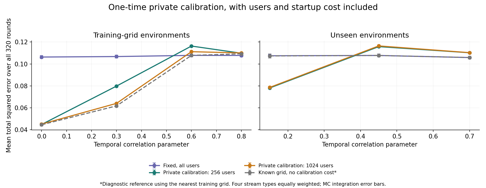

# 第十八次讨论：一次私有校准是否足够

日期：2026-11-04。接[第十七次讨论](2026-11-03-第十七次讨论-资源分配空间与固定混合验证.md)。

**本轮结论：在当前“每条流的时间相关程度固定、用户同分布、最多一个非零关联”的模型中，一次普通私有校准已经能取得明显收益，并接近预先知道环境的粗查表参照。普通线性插值还改善了未用于选参的环境。因此，应下调“必须发明新的在线判断/切换机制”的必要性判断。技术收益可行，不等于论文创新成立。短暂新关联仍未有效估计，应回到这个尚未解决的原始问题，而不是继续给校准叠模块。**

## 1. 为什么这轮是关键关卡

上一轮在有限配置族中观察到约25.5%的环境适应差距，但知道环境的参照没有支付学习环境的成本。每条流的时间相关程度λ又始终固定，可能只需早期校准就能选好一个固定方案。

本轮实际实现这个普通办法，并扣除校准成本。候选为本地历史16/32/64/128轮（筛选10240人），服务器窗口32/64轮（筛选15360人）及128轮（筛选10240人）。其余可用用户估计当前值。N20480、M256星形候选对、w20/ε1、关联强度.6保持不变。

**λ表示同一用户交叉符号的时间相关性，目标ρ表示不同属性之间的当时关联，两者不同。**各单属性边际仍均匀，用户之间独立，评价目标为总体ρ而不是某一次有限样本实现的统计量。

## 2. 校准不再免费

预留256或1024名用户，分别占全体1.25%或5%；这些用户只校准一次，之后整个实验不参加生产筛选和发布。

每人公开随机选择一个属性对j，在本地计算前两轮交叉符号是否同向：

$$Y_u=S_{u,j,0}S_{u,j,1}\in\{-1,+1\}.$$

对Y做一次ε=1的随机响应，上报1比特。公开随机坐标可由共享随机性确定，不额外计私有坐标上传。服务器由私有报告均值除以κ=tanh(.5)，估计λ，再按冻结的训练规则选择固定方案。算法不知道真实λ、关联位置、变化时刻或当前评价阶段。

生产筛选人数与对应固定候选相同；校准用户从后续发布人群中扣除。例如筛选15360人时，预留1024人校准后只剩4096人发布，单轮按公开相位有204或205人，风险及阈值都用实际人数计算。

校准方案在第0/1轮输出0，第1轮完成校准，第2轮起运行；无校准基线可从第0轮开始。长历史尚未积累好时输出0，这些启动误差也计入。校准轮最多1024比特，之后每轮也不超过1024比特。

隐私依据是三类互斥人群：校准者只做一次ε1报告；筛选者按固定历史跨度和周期会计；发布者20轮一次报告。校准者对后续选择的影响是其私有报告的后处理。对任一生产者，配置由独立人群决定，可条件化处理。这里没有校准后偷偷重用同一批用户，也没有漏计原始历史的重复访问。

## 3. 统一评价，不再只挑表现好的阶段

每条流从第0轮到第319轮全部计分，含启动、稳定、变化及恢复。四种流等权：一直存在关联；A在96—159轮活跃后转移到B，B分别持续8/32/96轮。每个λ下都使用同一选型规则，不按具体流或阶段换表。

训练λ为0/.3/.6/.8，每个计数分布300次筛选快照；冻结规则后，使用独立种子、1500次快照验证上述四点和未参与训练的.15/.45/.7。当前发布噪声和校准噪声均精确积分。

相同筛选计数分布会缓存复用抽样。区间计算先按每个Monte Carlo编号聚合全部时间及场景，再计算标准误，保留复用造成的计算相关性。**这仍是全时间范围的期望风险积分，不是完整连续轨迹重复，不能据此给出首次发现时延或全流误报率。**

预先写了[协议](analysis/2026-11-04-calibration/PROTOCOL.md)。新增63项校准通道、Markov乘积期望、决策概率、人数相位及通信检查通过；输出风险从固定策略风险与校准选择概率重新构建，最大数值差约1.67×10⁻¹⁶。

新指标包含完整320轮和四种流，**不能与上一轮只看迁移前96轮的.227/.169直接比较**。

## 4. 主实验：简单校准已经有净收益

下表均为相同公共阈值规则的总平方误差，越小越好。“训练网格复核”使用新随机种子，不是训练误差；“未见λ复核”只指相关程度没用于训练，其他模型结构未改变。

| 方法 | 训练网格复核，四λ平均 | 未见λ复核，三λ平均 |
|---|---:|---:|
| 全体用户、统一固定服务器h64方案 | 0.10715 | 0.10701 |
| 256人私有校准＋最近网格查表 | 0.08765 | 0.10136 |
| 1024人私有校准＋最近网格查表 | **0.08258** | 0.10178 |
| 预知λ、无校准成本、最近网格查表参照 | 0.08081 | 0.10697 |
| 始终输出0 | 0.18225 | 0.18225 |

在训练网格上，1024人校准相对强固定基线风险下降约22.9%；差值−.02458的约95% Monte Carlo区间为[−.02538,−.02377]。相比同样预留1024人、但知道λ的查表参照.08197，实际校准的额外风险约.000608。

256人校准的环境判断误差更大：λ=.3时，归入对应训练档的概率约74.4%；1024人约97.5%。但更多校准用户也会减少发布人数，所以不能理解为校准人数越多越好。例如λ=0时，256人方案.04473，1024人方案.04506。

实际效果也不是每个λ都改善：

| λ | 固定方案 | 1024人最近网格校准 |
|---|---:|---:|
| 0 | .10630 | **.04506** |
| .3 | .10675 | **.06400** |
| .6 | **.10782** | .11119 |
| .8 | **.10774** | .11005 |

较强相关时，固定服务器方案本来就合适，校准付出的成本可能没有被补回来。总体收益依赖预先规定的环境和流类型权重，不是对每条流都更好的保证。

## 5. 粗查表的损失不能当作创新空白

在未查看网格外结果前，又冻结了一条普通规则：把每个候选在四个训练λ上的风险作分段线性插值，给定私有校准估计值，选择插值风险最低的候选。

它使用同一份校准报告、同一预算和同一生产人群，没有额外查询真值，也不依据验证结果调整分界。该补充复用独立生成的固定策略风险与精确校准概率，不是另一套独立重复实验；由于CSV未保留全部策略间协方差，只报告点估计，不伪造区间。

| 普通插值校准 | 训练网格复核 | 未见λ复核 |
|---|---:|---:|
| 256人校准 | .08495 | .09227 |
| 1024人校准 | .08281 | **.08678** |

1024人插值方案在三个未见λ上的平均风险，比固定基线.10701低约18.9%。具体λ=.15/.45/.7的风险为.05085/.09910/.11038；最后一个仍不如固定基线.10584，不能写成每个未见环境都改善。

这也说明“预知λ的最近网格查表”只是粗参照，不是最优下界。λ=.15时，该参照选择本地16轮，风险约.10734；校准报告会在不同档位间随机落点，而插值能更合理地利用本地32轮等候选。因此实际校准可能胜过该粗参照，不能声称打破理论下界，也不适合用“填平了百分之多少最优差距”包装结果。

图中仅展示最近网格主实验；插值结果见上表和CSV。

## 6. 与隐私预算、误差的联系是实质的，但不是新理论

校准有两种不同成本：校准消息有噪声，可能选错生产配置；校准占用用户，使生产发布人数减少。更大的C会降低前一种成本，同时增加后一种成本。在未截断的校准估计中，方差上界为1/(Cκ²)，是普通随机响应方差计算。

校准前后配置也可能改变；比如1024人校准后，强相关环境的训练规则倾向选发布人数更多的server128配置。因此“付费参照−无成本参照”同时含人数、启动及重新选型效果，不能把它全说成单独的隐私噪声项。

不加公共阈值时，训练网格固定基线/1024校准风险为.11152/.08883；未见λ的固定基线/1024插值方案为.11136/.09207，收益不是完全由阈值制造。所有原样输出、阶段结果及资源账本均保存。

## 7. 这对创新判断意味着什么

应收缩这一主张：**“因为不知道时间相关程度，所以必须设计复杂的新在线预算切换机制。”**在当前受限模型中，普通一次校准已有明确反证：付出真实用户、报告及启动成本后，仍能获取明显收益；普通插值也能处理一部分训练网格之外的情况。

同时，不能把本轮直接包装成新论文方法：RR校准、离线选参、查表、插值和固定采集都是常规组件。本轮没有做新一轮穷尽文献检索，也没有推翻已有文献；第十六/十七轮列出的JASA2026、ICML2024和NeurIPS2018等查重边界继续适用。

正面结果依赖具体假设：所有用户和候选共享λ，每条流的λ固定；最多一个非零关联；训练与验证只有λ变化，信号强度、候选数、流结构等仍匹配。以恒定单非零关联为例，校准原始统计均值是λ+(1−λ)ρ²/M，偏差很小；多关联或异质用户下不自动成立。该结论不能推广为“任意真实数据流一次校准都够”。也不应为了维持创新判断，立刻人为加入更多难条件。

## 8. 仍未解决的原始问题与下一步

**持续8轮的新关联仍然没有有效估计。**最近网格1024校准方案在七个λ下的新关联活跃期风险约.3588—.3595，恒零为.36。全程风险下降主要来自其他阶段及合适的固定配置，不能把它当成短事件发现成功。

因此，下一步不再优先给“环境选型”叠模块，而是核查一个具体问题：

> **即使时间相关程度已经知道，短暂新关联仍无法可靠估计，究竟是w-event LDP与未知关联位置带来的必要信息成本，还是本地只保留第一名等压缩方式丢掉了有用信息？**

这仍直接属于数据流差分隐私的预算、样本量和误差问题。先比较未压缩原始信息、现有本地摘要及合格私有输出在同一资源下保留的可辨识信息，并核查近期相关理论；这只是下一项待验证问题，还不是新的创新结论。若强标准方法或已有下界已经解释了失败，应停止把该失败包装成论文空白。

当前状态：**技术可行性有证据；“环境自适应本身”作为独立创新的依据下降；短暂关联的误差来源尚未解释清楚。**尚未完成新机制、一般上下界、真实数据或完整SOTA比较。

## 9. 复现及交接

- [运行前协议与插值补充](analysis/2026-11-04-calibration/PROTOCOL.md)
- [主实验](analysis/2026-11-04-calibration/run_calibration.py)、[普通插值规则](analysis/2026-11-04-calibration/interpolation.py)、[核查和作图](analysis/2026-11-04-calibration/analyze.py)
- [冻结查表](analysis/2026-11-04-calibration/frozen_lookup.csv)、[冻结插值决策](analysis/2026-11-04-calibration/frozen_interpolation_decisions.csv)
- [主实验汇总及差值区间](analysis/2026-11-04-calibration/aggregate.csv)、[逐λ汇总](analysis/2026-11-04-calibration/validation_summary.csv)、[分阶段结果](analysis/2026-11-04-calibration/validation_scenes.csv)、[插值汇总](analysis/2026-11-04-calibration/interpolation_aggregate.csv)
- [校准选档概率](analysis/2026-11-04-calibration/calibration_probabilities.csv)、[资源账本](analysis/2026-11-04-calibration/resource_accounting.csv)、[输出核查](analysis/2026-11-04-calibration/output_checks.json)
- 复现：先运行主实验；训练完成后可运行`interpolation.py --freeze`；全部验证完成后运行`interpolation.py`与`analyze.py`。历史协议保留原始追加时点。下次先读本页与[handoff](handoff.md)。
