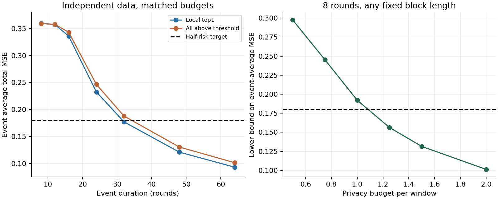

# 第二十次讨论 · 短暂关联需要持续多久，私有发布误差才能减半？

2026-11-11。承接[第十九次讨论](2026-11-04-第十九次讨论-短暂新关联的信息损失与受限机制界.md)。本轮检验同样的人数、预算和通信量下，允许用户保留多个候选属性对，能否让较短的事件也达到误差目标。

**目前有两个可检验的端点。** 在时间独立、固定分组和日程的一比特模型中，8轮事件的平均误差至少为0.19215，超过减半目标0.18。持续32轮时，一个已有的简单策略达到0.17703。由此可以研究最短可达时长落在哪里，以及它随预算怎样变化。保留多个候选的实验没有提供足以单独支撑算法创新的证据。

## 我们实际估计什么

把属性编码为±1。对一个参照属性与其余256个属性，分别计算同一用户、同一轮的符号乘积。各属性本身仍各有一半概率取正负值。如果某对属性同号的概率从50%变为80%，其乘积的期望就从0变为0.6。这256个期望值组成每轮待发布的关联向量。旧关联在第96至159轮活跃，第160轮起换成另一个位置。服务器在线选址时看不到旧位置、新位置、变化时刻、事件长度或时间相关参数。

指标是每轮对256个坐标求平方误差之和，再对事件持续的全部轮次取平均。始终发布零向量会漏掉唯一强度0.6的关联，误差为0.36。本轮沿用其一半0.18作为研究门槛。即使最后一轮完全找对，前面漏掉的轮次仍计入。知道正确位置时，用同样的512名发布者估计强度，期望误差仅为0.00866。[协议与指标](analysis/2026-11-11-duration/PROTOCOL.md)

## 一比特怎样表示多个属性对

两种方法都让用户读取最近若干轮记录，计算每对属性的平均乘积。第一种只保留绝对分数第一名。第二种把所有超过门槛（含等于）的坐标记为1，其余记为0。例如四对属性中第2、4对通过门槛，本地向量就是 `[0,1,0,1]`。服务器和用户事先共享一行随机正负号，用户把通过门槛的位置对应的符号相加，取正负，再用随机响应扰动后发出一比特。和为零时公平随机。服务器只见公开行和私有比特，靠多名用户共同估计候选得分。

共20,480名用户，一半筛选，另一半提供当轮发布值。隐私窗口为20轮，每窗口预算ε=1。每名筛选用户以固定长度b读取本地记录，每隔19+b轮报告一次。任意连续20轮原始数据至多影响该用户的一次报告。两种方案用相同的公布日程、每次一比特。在最终配对中，每轮实际筛选、发布人数也一致，每轮总上行最多1,024比特。筛选决定发布哪一对，另外512名用户独立估计这对属性在当轮的强度。

取5种历史长度、3种服务器汇总窗口，阈值方案另取3个阈值。按两种时间相关程度及7种时长等权选参，两种方案最终都读16轮历史，服务器都汇总8轮，阈值为0.75。先导实验每项384次，冻结后每项独立复核3,072次。32轮两种方案的初次同时区间均跨过0.18，因此保留原参数，用全新随机种子每种追加40,960次。[冻结配置](analysis/2026-11-11-duration/frozen.json) · [独立复核](analysis/2026-11-11-duration/confirmation32.csv)

## 事件越长，两种方案何时达标

| 新关联持续轮数 | 时间独立，只报第一名 | 时间独立，保留超过阈值的候选 | 时间相关λ=0.6，只报第一名 | 时间相关λ=0.6，保留超过阈值的候选 |
|---:|---:|---:|---:|---:|
| 8 | 0.3598 | 0.3595 | 0.3592 | 0.3589 |
| 12 | 0.3576 | 0.3580 | 0.3588 | 0.3586 |
| 16 | 0.3361 | 0.3433 | 0.3585 | 0.3579 |
| 24 | 0.2327 | 0.2465 | 0.3578 | 0.3540 |
| 32 | **0.17703** | **0.18782** | 0.3570 | 0.3515 |
| 48 | 0.1209 | 0.1304 | 0.3566 | 0.3488 |
| 64 | 0.0930 | 0.1013 | 0.3562 | 0.3475 |

λ刻画同一用户跨轮观测的相关程度，属性对在事件期间的关联强度始终为0.6。32轮、时间独立时，两种方案的95%同时蒙特卡洛区间分别为[0.17446, 0.17960]和[0.18525, 0.19039]。时间独立时，48轮两种方案均达标。λ=0.6时，延长到64轮，两种冻结方案仍远高于0.18。这一列只计算事件期平均误差，整条轨迹的误报率与检测延迟还需单独评价。[主复核数据](analysis/2026-11-11-duration/confirmation.csv) · [32轮追加复核](analysis/2026-11-11-duration/confirmation32.csv)

上一轮要求做一个更严格的配对检验。在时间独立的5种历史长度×7种时长中，查找“多候选的确认误差上限低于0.18，同时相同历史长度下一切先取第一名、再做非交互私有化的方案都有高于0.18的误差下界”。35个组合均未满足。上界和下界之间的空隙仍可能包含更好的采集方式。[第一名摘要的类别界](analysis/2026-11-11-duration/bounds.csv)

## 为什么8轮可以得到更强的判断

设新位置均匀地落在旧位置之外的255个候选中。即使把旧位置、变化时刻和信号强度告诉服务器，用户在最初几轮也只看到了少量包含新关联的观测。我们从完整原始记录块出发，上界任意单条ε-LDP比特能透露多少关于新位置的信息，再按每轮实际人数累加。若选错位置，本轮漏掉的真实坐标单独就产生0.36的平方误差。将各轮可达到的定位成功率换算为误差，得到下表。[完整推导与假设](analysis/2026-11-11-duration/RAW-BOUND.md)

| 窗口隐私预算ε | 8轮事件的平均误差下界 | 对0.18目标的判断 |
|---:|---:|---|
| 0.50 | 0.29763 | 当前条件下无法达到 |
| 0.75 | 0.24529 | 当前条件下无法达到 |
| 1.00 | **0.19215** | 当前条件下无法达到 |
| 1.25 | 0.15632 | 此界已低于目标，可达性待验证 |
| 1.50 | 0.13145 | 可达性待验证 |
| 2.00 | 0.10122 | 可达性待验证 |

反解得到，8轮要达标，预算至少须达到约 **ε=1.07156**，其余资源和模型保持本轮设定。这个数是必要条件，证明放宽到该处就能达标还需要构造可行方法。8轮、ε=1的下界覆盖任意统一选定的正整数历史长度与任意非交互一比特原始块编码。它按未知新位置平均，也约束最坏位置的风险。固定人数分组、固定相位日程、跨轮独立、只从筛选报告选址均进入了推导。交互式查询、用户间采用不同历史长度、改变筛选和发布的人数分配都需要重新分析。[不同预算下的数值](analysis/2026-11-11-duration/raw_bound_all_histories.csv) · [预算临界值](analysis/2026-11-11-duration/budget_boundary.csv)

在相同起点，较短事件到结束时只有较长事件的前缀，累计信息上界逐轮增加。因此通过这条下界也能排除8轮以内达标。32轮的可行证据是上述合成实验，表中其余配置的表现不能代替所有合法机制的最优性证明。对均匀位置作比较时，第一名基线用公开均匀Hadamard行、对称随机响应和均匀平局处理，固定旧位置的可逆仿射坐标置换能交换任意两个新位置，置换只重排行并统一翻转部分行的符号，因此其期望风险对新位置相同。

## 创新判断与下一次从哪里接

多坐标筛选已经有直接文献先例。Kent、Berrett、Yu 的 JASA 论文 Algorithm 6 在用户本地保留多个过阈坐标，再用公开随机投影进行私有投票。本轮将该思路适配到固定的一比特通信，并沿用自己的服务器解码。论文原算法还使用了裁剪和加噪，复现整个流程需要单独对照。Acharya 等也已为通信或隐私约束下的高维估计建立信息下界。论文层面的新颖性还须逐项对照这些结果的统计模型、时间范围和损失函数。[JASA 论文](https://doi.org/10.1080/01621459.2026.2677739) · [作者全文第4节](https://arxiv.org/html/2405.11923v3#S4) · [高维估计的信息下界](https://arxiv.org/abs/2010.06562)

**给定窗口隐私预算、总人数和逐轮通信量，一个位置未知的关联至少要持续多少轮，事件期间的发布误差才能减半？** 当前独立数据模型下，已有证据把最短时长夹在9至32轮。下一次优先核查9至31轮，先用现有简单方法找最短可达时长，再看缩小理论和实测间的差距需要更紧的分析还是改变采集方式。若经典静态结果经逐轮求和便能得到同等精度，论文贡献需要相应收窄。时间相关的下界、真实数据及完整已发表方法对照仍待完成。

### 复核材料

- 采集分布、人数核对、参数选择与主实验见[主程序](analysis/2026-11-11-duration/duration_sweep.py)、[先导实验](analysis/2026-11-11-duration/pilot.csv)及[核查结果](analysis/2026-11-11-duration/checks.json)。
- 独立种子复核32轮见[追加复核程序](analysis/2026-11-11-duration/confirm32.py)。理论数值在小模型上枚举64个原始块，校验300个通道，并逐个核算历史长度1至512。更长历史由解析尾界覆盖。[下界计算](analysis/2026-11-11-duration/raw_bound.py) · [数值核查](analysis/2026-11-11-duration/raw_bound_checks.json)
